# معمارية الفهرس الدلالي لطبقة التهيئة الذكية (`PR-2`)

**المشروع:** `GP-Project-ust/Bayan` (`Sprint 1 — Issue #7`)  
**الفرع:** `feature/issue-7-semantic-catalog` (مبني فوق `feature/issue-7-discovery`)  
**المرجع الأكاديمي:** الفصل الرابع §4.3.4 (الفهرس الدلالي ومكوناته الستة) و§4.4.2 (القاعدة الداخلية `PostgreSQL 16 + pgvector`)

---

## 1. الفصل المعماري المسؤوليات

تُقسم طبقة التهيئة الذكية في [backend/app/services/onboarding/](file:///C:/Bayan/backend/app/services/onboarding/__init__.py) إلى أربع مراحل متسلسلة ومنفصلة:

1. **الاستبطان الحتمي (`discovery/` — PR-1):** استخراج الجداول والمشاهد والأعمدة والمفاتيح والتعليقات (`COMMENT ON`) والإحصاءات التقريبية من قاعدة مصدر العميل بوضع القراءة فقط، وتوليد أوصاف عربية حتمية (Zero-LLM) وتقرير عربي وبصمات SHA-256 تفصل البنية عن عدد الصفوف ومعلومات الاتصال.
2. **بناء السجلات والتضمين والفهرسة (`indexing/` — PR-2):** تحويل تقرير الاكتشاف إلى وحدات فهرس دلالي نظيفة، وفحص البصمات لتضمين العناصر الجديدة أو المتغيرة فقط عبر `app.core.qdrant.get_embeddings`، وحفظها في قاعدة المنصة (`PostgreSQL + pgvector`).
3. **إسقاط الكتالوج (`catalog/` — PR-2):** قراءة المشاهد المعتمدة من الفهرس وإرجاعها عبر `SemanticCatalogV2Provider.get_catalog(allowed_views=None)` بنفس أنواع العقد المجمد (`CatalogEntry` و`CatalogColumn`).
4. **الاسترجاع الدلالي (`SemanticSearchService`):** البحث باللغة العربية أو الإنجليزية فوق البيانات الوصفية فقط، مع تطبيق نطاق المستأجر والمصدر والمشاهد المسموحة قبل إرجاع النتائج.

```mermaid
flowchart LR
    Src[("قاعدة العميل Source DB\n(قراءة فقط ODOO_DB_*)")] --> Intro["discovery/PostgresIntrospector\n(information_schema + pg_catalog)"]
    Intro --> Norm["normalization + fingerprints\n(فصل البنية عن الإحصاءات)"]
    Norm --> Desc["DeterministicArabicDescriber\n(COMMENT أولاً ثم قالب حتمي — Zero-LLM)"]
    Desc --> Builder["indexing/SemanticEntryBuilder\n(table, view, column, relationship, concept)"]
    Builder --> Diff{"مقارنة content_hash\nو embedding_config_id"}
    Diff -- "غير متغير" --> Skip["تخطي وإعادة استخدام المتجه"]
    Diff -- "جديد أو متغير" --> Emb["OfficialEmbeddingService\n(app.core.qdrant.get_embeddings)"]
    Emb --> PgVec[("قاعدة المنصة DATABASE_URL\npgvector: onboarding_semantic_entries")]
    Skip --> PgVec
    PgVec --> Search["SemanticSearchService\n(عزل tenant_id + allowed_views)"]
    PgVec --> CatV2["catalog/SemanticCatalogV2Provider\n(CatalogEntry + CatalogColumn المجمدة)"]
```

---

## 2. أنواع وحدات الفهرس الدلالي ومطابقتها للفصل الرابع §4.3.4

يولّد [builder.py](file:///C:/Bayan/backend/app/services/onboarding/indexing/builder.py) خمسة أنواع دلالية تغطي مكونات الفهرس الدلالي الستة الموثقة في الفصل الرابع (مع تخصيص المكوّن السادس لعمود المتجهات `embedding vector(1024)` في كل صف):

| نوع الوحدة (`entry_type`) | المقابل في الجدول 4.x (الفصل الرابع §4.3.4) | المصدر الأساسي |
| --- | --- | --- |
| `table` | فهرس النماذج والجداول | الجداول الفيزيائية المستبطنة (للربط الدلالي والفهم؛ لا تُعرض لوكيل SQL مباشرة) |
| `view` | فهرس أوصاف العروض | مشاهد SQL الموصوفة بالعربية مع قائمة أعمدتها (`metadata_payload.columns`) |
| `column` | فهرس الحقول | الأعمدة، أنواعها، وصفها العربي، ودورها الدلالي (`identifier` / `measure_*` / `time_attribute`) |
| `relationship` | فهرس العلاقات | المفاتيح الأجنبية المعلنة (الأحادية والمركبة مثل `fk_confirmations_route_stop`) |
| `concept` | قاموس المصطلحات | المصطلحات العربية المفتاحية المستخلصة حتمياً من التعليقات وأسماء الكائنات |

---

## 3. الضوابط الصارمة في البيانات المفهرسة

يفحص `validate_safe_semantic_payload` في [models.py](file:///C:/Bayan/backend/app/services/onboarding/indexing/models.py) كل سجل قبل تضمينه أو حفظه:
- **منع SQL التنفيذي:** يُرفض أي نص أو حمولة تحوي `SELECT ... FROM` أو `CREATE VIEW` أو حقول `view_definition` / `sql_query`.
- **منع الأسرار والاعتمادات:** يُمنع حفظ `password` أو `dsn` أو `postgresql://...`.
- **منع صفوف الأعمال:** لا تُقرأ ولا تُضمّن سجلات الطلاب أو الفواتير أو الشحنات؛ الفهرسة للميتاداتا الوصفية فقط.
