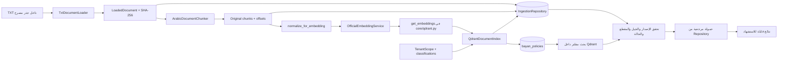
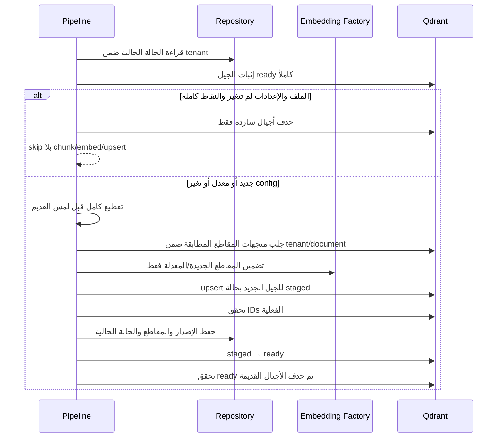

# معمارية فهرسة المستندات الدلالية — PR-3

## 1. النطاق والمرجع

تنفذ الحزمة `backend/app/services/ingestion/` مسار TXT فقط في Sprint 1:

```text
TXT موثوق المصدر → تحقق وتحميل → تطبيع للتضمين → تقطيع حتمي
→ get_embeddings() → bayan_policies/Qdrant → تحقق مرجعي قبل الإرجاع
```

المرجع الأكاديمي هو `Bayan-Documentation` عند commit `1415cf5`، ولا سيما:

- `UC-02` و`FR-16` و`FR-18` و`FR-20` في الفصل الثالث.
- §4.4.3 والفصل الرابع، الصفحة المطبوعة 106: الجداول 4-41 و4-42 و4-43.
- الصفحة المطبوعة 110: الجدول 4-47 وحمولة Qdrant.
- ADR-005: المصنع الرسمي و`bge-m3` بدلاً من `multilingual-e5-large`.

## 2. تدفق المكونات



## 3. مسؤوليات الوحدات

| الوحدة | المسؤولية |
|---|---|
| `models.py` | نماذج المجال، الحالة المرجعية، النتائج والعدادات. |
| `exceptions.py` | أخطاء مصنفة برسائل آمنة لا تسرب النص أو الاعتمادات. |
| `loader.py` | TXT/UTF-8 وBOM والحجم والمسار والرأس والملكية والتصنيف. |
| `normalizer.py` | NFC والمسافات والأسطر للتضمين فقط؛ لا يمس النص الأصلي. |
| `chunker.py` | مواد وفقرات عربية، CRLF/CR، long-split، overlap، offsets وترتيب حتمي. |
| `identity.py` | فصل مجالات SHA-256 واشتقاق UUID صالح لنقطة Qdrant. |
| `embedder.py` | دفعات وتحقق عدد/بعد/finite وإعادة محدودة عبر المصنع الرسمي. |
| `tenant_scope.py` | منع افتراضي، مؤسسة إلزامية، NFC/مسافات، ورفض المحارف غير المرئية. |
| `repository.py` | عقد التخزين المرجعي وتطبيق SQLite محلي متوافق الحقول. |
| `indexer.py` | تحقق المجموعة، عمليات Qdrant المفلترة، `staged/ready`، ودورة حياة كل التصنيفات. |
| `pipeline.py` | التزايدية، إعادة استخدام المتجهات، التقاعد، السحب، المصالحة، والحمولة المرجعية. |

## 4. فصل مسؤوليات التخزين

### PostgreSQL المخطط أكاديمياً

يبقى مصدر الحقيقة النهائي للكيانات:

- `documents(document_id, tenant_id, title, document_type, security_level, status)`
- `document_versions(version_id, document_id, version_no, file_path, file_hash, created_at)`
- `document_chunks(chunk_id, version_id, chunk_no, content, page_no, qdrant_point_id)`

لا توجد هذه الجداول أو migrations في baseline `origin/dev`. تجنب PR-3 إنشاء migration
غير معتمد. عُرّف `IngestionRepository`، واستُخدم `SQLiteIngestionRepository` في أداة
`/dev/indexer` فقط بمخطط يحمل الأسماء والحقول الأساسية نفسها ويحفظ النصوص والإصدارات
والمقاطع خارج Qdrant. كل اتصال SQLite قصير العمر ويُغلق في `finally`، حتى لا تبقى
معاملات أو مقابض مفتوحة على Windows. المطلوب قبل الإنتاج هو Adapter PostgreSQL
ومراجعة migration من مالك مخطط المنصة.

### pgvector

غير مستخدم في PR-3. يبقى للفهرس الدلالي لمخطط قاعدة البيانات وCatalog v2.

### Qdrant

يخزن متجه المقطع والحمولة اللازمة لاختيار المرشحين. **ليس مصدر الحقيقة** لنص
النتيجة أو تصنيفها أو استشهادها؛ هذه تُقرأ من Repository بعد التحقق. ولا توجد
مجموعة لكل مستأجر أو مستند؛ المجموعة الموحدة هي `bayan_policies` وبمسافة
`Cosine`.

## 5. استراتيجية الهوية

كل دالة تستخدم JSON قانونياً ونطاقاً ثابتاً `bayan.document-ingestion.sha256.v1`:

```text
file_hash       = SHA256(raw UTF-8 bytes)
document_id     = SHA256("document", tenant_id, source_reference)
version_id      = SHA256("document-version", document_id, version_no, file_hash)
chunk_id        = SHA256("document-chunk", version_id, chunk_config,
                         chunk_no, start_offset, end_offset, content_hash)
indexing_key    = SHA256("indexing-generation", version_id,
                         chunk_config, embedding_config)
point_sha256    = SHA256("qdrant-point", chunk_id, embedding_config)
qdrant_point_id = RFC-4122 UUID مشتق من أول 128 بت من point_sha256
```

تمنع السلسلة التصادم المنطقي بين المؤسسات والوثائق المتطابقة والإصدارات والمواضع
المكررة. تبقى بصمة SHA-256 الكاملة في الحمولة والمستودع، فلا يكون UUID المختصر
المرجع الوحيد.

## 6. التقطيع العربي

1. يحتفظ `LoadedDocument.source_text` بالنص المفكوك من UTF-8 كما هو.
2. يكتشف التقطيع بدايات `المادة N:` و`مادة N:` و`Article N:`.
3. تبقى المادة كتلة واحدة ما دامت دون `chunk_size`.
4. تُقسّم المادة الطويلة عند آخر علامة ترقيم/سطر مناسبة قبل الحد، وإلا بحد صلب.
5. يطبق `overlap` داخل المادة الطويلة فقط.
6. يحمل كل مقطع `start_offset` و`end_offset` و`article_id` و`section`.
7. `page_number=null` لملفات TXT؛ لا يُختلق رقم صفحة.
8. يستخدم النص المطبع للتضمين، بينما تحفظ الحمولة النص الأصلي للاستشهاد.
9. الخوارزمية `arabic-sections-v2` تفصل الفقرات عند `\r\n\r\n` و`\r\r` وأي
   مزيج، لا عند `\n\n` فقط. تكافؤ CRLF/LF مثبت على اللوائح الخمس.

## 7. خوارزمية الفهرسة التزايدية



- إذا فشل التحضير أو الرفع، يبقى الجيل القديم `ready`.
- نقاط `staged` لا تدخل فلتر البحث، وتنظف بأفضل جهد.
- إذا انقطع التنفيذ بعد تفعيل الجديد وقبل حذف القديم، تعيد المحاولة المصالحة وتحذف
  كل جيل لا يطابق `indexing_key` الحالي.
- التقاعد بعد نجاح الجيل الجديد يفلتر بـ`tenant_id + document_id` فقط، فيشمل
  بقايا تصنيف سابق أو تالف لنفس المستند ولا يتجاوز المؤسسة.
- السحب بعد التحقق من الحالة المرجعية يفعل الأمر نفسه، فيزيل كل نقاط المستند
  داخل مؤسسته مهما كان تصنيفها.
- حذف ملفات المصدر غير تلقائي: يلزم `retire_missing=True` مع مجموعة مستأجرين
  صريحة وبعد نجاح تحميل كل الملفات الموجودة.
- سرد مجلد المزامنة يستبعد `withdrawn` في SQLite وInMemory معاً، فلا تُعاد
  عدّة المستند المسحوب عند تكرار المزامنة.

## 8. عقد الحمولة

### حقول التوافق الحالية

`tenant`, `document`, `version`, `section`, `classification`, `text`, `source_file`.

### حقول الفصل الرابع القانونية

`tenant_id`, `document_id`, `version_id`, `chunk_id`, `page_number`,
`security_level`.

### حقول التتبع الإضافية

`chunk_no`, `article_id`, `start_offset`, `end_offset`, `source_reference`,
`file_hash`, `content_hash`, هويات SHA-256، بصمات التقطيع والتضمين، بيانات النموذج،
`indexing_key`, و`indexing_status`.

لا تحفظ الحمولة مساراً مطلقاً أو اعتماد اتصال أو مفتاح API.

### سلطة الإرجاع

حمولة Qdrant **مرشحة فقط**. عند البحث يتحقق Pipeline من
`tenant_id/document_id/version_id/indexing_key/chunk_id/qdrant_point_id` وحالة
المستند في Repository، ثم يبني حمولة الإرجاع من الحالة المرجعية والمقطع
المحفوظ. لذلك لا يستطيع العبث بـ`text` أو `section` أو `classification` أو
`content_hash` في Qdrant تغيير ما يقرأه المستخدم. الحقول الإضافية غير الحساسة
تبقى للتوافق.

## 9. نقطة التكامل المستقبلية مع RAG

`DocumentIngestionPipeline.search(scope, query, top_k)` واجهة قابلة لإعادة الاستخدام:

1. تقليم السؤال وتضمينه عبر المصنع الرسمي.
2. فلترة `tenant_id + security_level + indexing_status=ready` داخل Qdrant.
3. إعادة مطابقة `document_id/version_id/indexing_key/chunk_id/qdrant_point_id`
   وحالة المستند في Repository.
4. إسقاط أي مرشح قديم أو غير مصرح به بصمت (fail closed) بدل تعطيل البحث كله.
5. إعادة النص والتصنيف والاستشهاد من Repository لا من الحمولة المرشحة.

لم يُعدّل `rag_agent.py` أو `supervisor.py` أو أي عقد مجمد ضمن PR-3.
