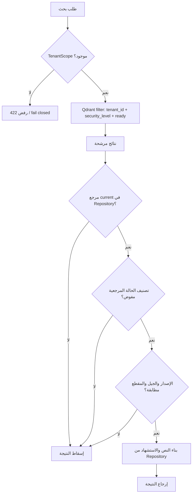

# أمن فهرسة المستندات وعزل المؤسسات — PR-3

## 1. مبادئ الإنفاذ

- **المنع الافتراضي:** لا بحث أو إحصاء أو قراءة مباشرة أو تعديل أو حذف بلا
  `TenantScope` صالح وتصنيف واحد مصرح به على الأقل.
- **الفلترة في Qdrant:** لا يعتمد النظام على ترشيح النتائج بعد الاسترجاع؛ يدخل
  `tenant_id` و`security_level` في `query_filter`/`scroll_filter`/مرشح الكتابة.
- **الدفاع المتعدد:** يتحقق Pipeline بعد البحث من الحالة والإصدار والجيل والمقطع
  في Repository قبل إرجاع النص، ثم يبني النص والاستشهاد من Repository.
- **عدم الثقة بالحمولة:** حمولة Qdrant مرشحة فقط؛ لا يُعاد نصها أو تصنيفها إلى
  المستخدم حتى لو طابقت المعرّفات.
- **أدنى امتياز:** أداة التطوير تمنح البحث في التصنيف `عام` فقط.
- **فصل الهوية:** معرفات المستند والمقطع والنقطة مشتقة من المؤسسة أيضاً.
- **هوية مؤسسة قياسية:** NFC وتوحيد المسافات ورفض المحارف غير المرئية والمتحكمات،
  لمنع `Tenant A` و`Tenant\u200bA` من الظهور كمؤسستين مختلفتين.
- **دورة حياة كاملة:** تقاعد/سحب المستند يزيل كل تصنيفاته داخل المؤسسة، لا
  التصنيف الحالي فقط.

## 2. حدود الثقة

المصادقة وRBAC المنتج غير موجودين في baseline. لذلك فإن `tenant` في
`/dev/indexer/search` هو **سياق تطوير فقط** وليس ادعاء هوية موثوقة. الحقل بقي
ضمن Request schema القديم، لكن غيابه يرفض التنفيذ. يجب أن يستبدله سياق عضوية
مصادق عليه عند بناء API المنتج، كما تنص §4.5.

## 3. التصنيفات الأمنية

القيم الفعلية الموجودة في `database/documents_demo/README.md` هي:

- `عام`
- `داخلي`
- `سري`

لم تُخترع قيم جديدة. `TenantScope.public_only()` يسمح بـ`عام` فقط، بينما
`trusted_all()` مخصص لعمليات الصيانة الداخلية ولا يُبنى من طلب عام.

هوية المؤسسة تُطبَّع بـNFC وتُحوَّل كل سلسلة مسافات إلى مسافة ASCII واحدة، ثم
تُرفض إن احتوت أي محرف من فئات `Cc/Cf/Cs/Co/Cn/Zl/Zp` (تحكم، تنسيق/غير مرئي،
بدائل، خاصة، غير مخصص، فواصل أسطر/فقرات). هذا يمنع zero-width space وbidi
override والسطر الجديد وNUL. الحروف المتشابهة بصرياً (confusables) تبقى خارج
هذا الفحص وتحتاج توحيداً على مستوى المصادقة/الكتالوج.

مستويات `Public/Masked/Restricted/Blacklist` الأكاديمية تخص سياسة المنصة
الكاملة. ربطها بـRBAC وعضويات المستخدمين مؤجل لأن بنية المصادقة والجداول لم
تُنفذ بعد؛ لا يدعي PR-3 إكمالها.

## 4. حماية عمليات النقاط

| العملية | المرشح الإلزامي |
|---|---|
| البحث | `tenant_id` + التصنيفات + `indexing_status=ready` |
| الإحصاء | المرشح نفسه، دون إحصاء عالمي في واجهة الخدمة القابلة لإعادة الاستخدام |
| القراءة بمعرف | المرشح السابق + `HasIdCondition` داخل `scroll` |
| تحديث الحمولة | المرشح السابق + `HasIdCondition`؛ كل حقول العزل والهوية ودورة الحياة والنص محمية |
| الحذف المباشر | المرشح السابق + `HasIdCondition` |
| تقاعد إصدار | المؤسسة + `document_id` + استثناء الجيل الحالي، بلا قيد تصنيف |
| السحب | المؤسسة + `document_id`، بلا قيد تصنيف بعد تفويض الحالة المرجعية |

قائمة الحقول المحمية في `update_points_payload` تشمل: `tenant`, `tenant_id`,
`document`, `document_id`, `version`, `version_id`, `version_no`, `section`,
`classification`, `security_level`, `indexing_status`, `indexing_key`,
`chunk_id`, `chunk_no`, جميع بصمات SHA-256، `text`, `content`, `content_hash`,
`embedding_text_hash`, `file_hash`, `source_reference`, `source_file`,
`article_id`, `page_number`, `start_offset`, `end_offset`, `document_status`,
`document_type`, `title`, وبصمات التقطيع والتضمين وبيانات النموذج. الحقول
الإضافية غير الحساسة فقط قابلة للتحديث العام.

لا تستخدم عمليات الحذف والتحديث قائمة IDs وحدها؛ وبذلك لا يتيح تسريب UUID نقطة
من مؤسسة B لمستخدم مؤسسة A تغييرها أو حذفها.

## 5. حماية الملفات والنصوص

- `Path.resolve(strict=True)` ثم `is_relative_to(root)` يمنع `../` والروابط
  التي تخرج من الجذر المصرح.
- TXT فقط؛ امتدادات PDF/DOCX/OCR خارج النطاق.
- حد افتراضي 2 MiB قبل فك الترميز، وإعادة تحقق بعد القراءة.
- UTF-8 أو UTF-8 BOM فقط؛ رفض bytes غير الصالحة وNUL.
- رفض المستند الفارغ أو الرأس الناقص أو التصنيف غير المعتمد.
- لا يُرسل النص إلى مولد لغوي؛ التضمين فقط عبر ADR-005.
- لا تسجل الأخطاء النص الكامل أو مفاتيح أو بيانات اتصال.
- `/dev/indexer` لا يعيد المسار المطلق عند غياب مجلد المستندات؛ المسار في السجل
  فقط. أخطاء Qdrant/التضمين/فحص المجموعة تعيد 503 منقحة، والاستعلام الفارغ أو
  المستأجر غير الصالح يعيد 422 قبل أي تضمين أو استرجاع.

## 6. سلامة التحديث والفشل

- يجهز التقطيع والمتجهات قبل إزالة أي نقطة صالحة.
- الجيل الجديد يبدأ `staged` فلا يظهر للبحث.
- لا يصبح `ready` إلا بعد upsert والتحقق وحفظ المرجع.
- لا يتقاعد القديم إلا بعد التحقق من الجيل الجديد.
- فشل دفعة أو Repository لا يعلن نجاحاً ويترك القديم قابلاً للبحث.
- مصالحة إعادة المحاولة تعالج الانقطاع بين التفعيل والتقاعد.
- إذا فشل تقاعد جيل بتصنيف سابق، يبقى البحث العام آمناً لأن تصنيف الحالة
  المرجعية هو الحاكم، وتعيد المحاولة إزالة البقايا.
- البحث لا يرفع استثناء عند رؤية مرشح قديم بتصنيف غير مصرح؛ يسقطه ويكمل.
- نص النتيجة لا يأتي من Qdrant؛ العبث بالحمولة لا يغير النص أو التصنيف أو
  الاستشهاد الراجع للمستخدم.

## 7. دليل الاختبار السلبي الإلزامي

`backend/tests/test_ingestion/test_tenant_isolation.py` ينفذ فعلياً على
`QdrantClient(":memory:")`:

1. يفهرس نصاً متطابقاً لمؤسستين A وB.
2. يبحث لكل مؤسسة ويثبت أن كل payload يعود لها وحدها.
3. يحاول A قراءة نقطة B مباشرة: صفر نتائج.
4. يحاول A تعديل نقطة B: عدد المتأثر صفر، والحمولة لم تتغير.
5. يحاول A حذف نقطة B: عدد المتأثر صفر، والنقطة باقية.
6. يحاول A سحب مستند B: `DocumentNotFoundError` دون كشف المورد.
7. يحاول البحث والإحصاء بلا سياق: `TenantIsolationError`.
8. يثبت أن `عام` لا يعيد `داخلي`، وأن السياق المفوض فقط يرى الاثنين.
9. يعبث بحمولة Qdrant (`text/content/section/content_hash`) بعد الفهرسة، ويثبت
   أن البحث يعيد قيم Repository.
10. يحول حمولة مقطع داخلي إلى `عام` في Qdrant، ويثبت أن البحث العام يسقطه
    بلا استثناء وأن السياق المفوض يعيد تصنيفه المرجعي.
11. يترك بقايا تصنيف غير معروف لنفس المستند، ويثبت أن السحب يحذفها كلها.
12. يختبر zero-width وbidi override والسطر الجديد وNUL في هوية المؤسسة: رفض.
13. يختبر NFC وتوحيد المسافات: قبول حتمي دون تغيير الحروف العربية.
14. يختبر محاولة تعديل `indexing_status`/`indexing_key`/`chunk_id`/`text`
    وبصمات الهوية عبر التحديث العام: `TenantIsolationError`.

## 8. القيود الأمنية المتبقية

- لا توجد مصادقة أو عضويات/RBAC منتجة في baseline؛ `/dev/indexer` معطل عند
  `ENABLE_PLAYGROUND=false` لكنه ليس API إدارة مستندات إنتاجياً.
- `GET /dev/indexer/status` يحافظ على عقد التطوير القديم ويعرض العدد العالمي
  للمجموعة؛ لا يستخدم لاستدلالات مستأجرية في الإنتاج.
- تطبيق Repository الحالي SQLite محلي؛ سياسات PostgreSQL RLS وقيود المؤسسة
  المركبة تتطلب migration معتمداً لاحقاً.
- لا يوجد Audit Log علائقي منفذ لفشل الفهرسة بعد؛ تسجل رسائل منقحة في logger.
- الحروف المتشابهة بصرياً (مثل اختلاف الألف/الهمزة أو محارف لاتينية/سيريلية
  متشابهة) لا توحدها NFC؛ منع انتحالها يحتاج كتالوج مؤسسات موثوقاً وربط الهوية
  بعضوية مصادق عليها.
- `/dev/indexer` أداة تطوير: `tenant` يأتي من الطلب وليس من token موثوق. لا
  يجوز اعتباره حد أمان إنتاجياً قبل بناء المصادقة وRBAC.
