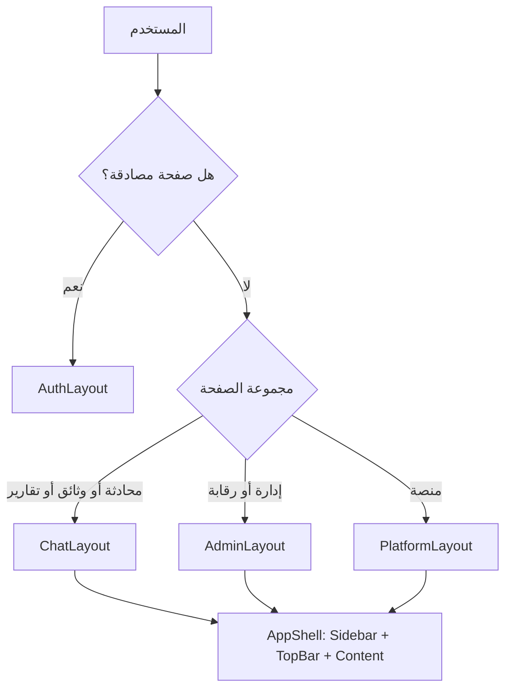

# نظام تصميم بيان — المرحلة 3/7: هياكل الصفحات (Layouts)

## النطاق

تم تنفيذ هياكل صفحات عامة باستخدام Next.js App Router وTypeScript على مشروع المرحلة الثانية دون تغيير أنماط `app/globals.css` أو ملفي الصور المرجعيتين.

## الملفات

| المكون | المسار | الغرض |
| --- | --- | --- |
| AppShell | `components/layout/AppShell.tsx` | الإطار الموحد (شريط جانبي + ترويسة + منطقة محتوى) |
| ChatLayout | `components/layout/ChatLayout.tsx` | محادثة المستخدم والصفحات الفرعية الاعتيادية |
| AdminLayout | `components/layout/AdminLayout.tsx` | لوحة المؤسسة وشاشات الإدارة والرقابة |
| PlatformLayout | `components/layout/PlatformLayout.tsx` | شاشات مسؤول المنصة، مع عنوان دور توضيحي |
| AuthLayout | `components/layout/AuthLayout.tsx` | صفحات تسجيل الدخول واستعادة كلمة المرور دون قائمة جانبية |
| FeatureLayout | `components/layout/FeatureLayout.tsx` | اختيار تخطيط الشاشات الفرعية وفق مجموعتها في كتالوج الشاشات |

## تطبيق حقيقي على صفحات المشروع

- `/` → `ChatView` → `ChatLayout` → `AppShell` (تحتفظ بنفس الفئات القديمة: `app-layout chat-layout` و`workspace chat-workspace`).
- `/admin` → `AdminDashboard` → `AdminLayout` → `AppShell` (تحتفظ بالفئات القديمة `admin-layout` و`admin-workspace`).
- `/admin/users`, `/admin/smart-views`, `/admin/audit` وغيرها → `FeaturePage` → `FeatureLayout` → `AdminLayout`.
- شاشات البحث والتقارير وغيرها → `FeaturePage` → `FeatureLayout` → `ChatLayout`.
- `/platform/organizations` وغيرها → `PlatformLayout` (يعرض «مسؤول المنصة» كمؤشر بصري فقط).
- `/login`, `/forgot-password` → `AuthLayout`.
- صفحة توضيح المرحلة: `/design-system/layouts`.

## قواعد المطابقة البصرية

1. هيكل DOM الأساسي لمحتوى المحادثة ولوحة الإدارة باقٍ كما كان؛ فقط نقلنا شريطي القائمة والترويسة إلى مكون واحد يعاد استعماله.
2. لم نعدّل `app/globals.css`، أو `styles/bayan-tokens.css`، أو الصور المرجعية.
3. المكونات الجديدة تستعمل فئات CSS الموجودة، ولم تفرض أنماطاً جديدة على `/` أو `/admin`.
4. نافذة `AdminDashboard` التجريبية ثابتة الموضع، لذلك بقيت مرئية فوق الصفحة رغم تغيير مستوى احتوائها إلى داخل الإطار الموحد.

## تسلسل التنقل

## اختبار القبول المقترح على جهازك

1. `npm install` ثم `npm run lint` ثم `npm run build`.
2. افتح `/` وتأكد من الاقتراحات وعرض SQL وتصدير CSV.
3. افتح `/admin` وتأكد من جدول المستخدمين وإضافة مستخدم ونافذة إضافة عرض ذكي.
4. افتح `/admin/users` ثم `/platform/organizations` ثم `/reports` وتأكد من شريط التنقل والعنوان.
5. افتح `/login` وتأكد من عدم ظهور الشريط الجانبي.
6. افتح `/design-system/layouts` للتنقل بين الأشكال الأربعة.
7. قارن الصور الأصلية في `design-references/` مع العرض على شاشة 1448 × 1086.

## حدود التنفيذ

هذه المرحلة تعالج التنقل والتركيب البصري فقط. لا تُطبّق تسجيل دخول حقيقيًا أو سياسات RBAC أو عزل المؤسسات. يجب تنفيذ تلك الوظائف والتحقق منها على الخادم قبل التشغيل الإنتاجي. لا نعلن نجاح البناء إلا عند اكتمال فحوص Next.js الفعلية.
