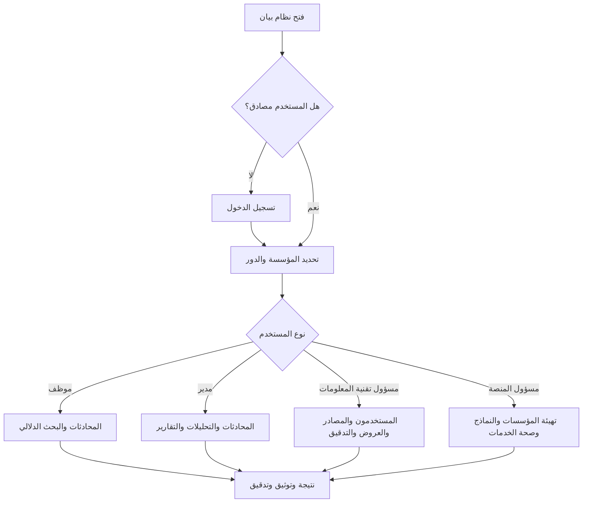
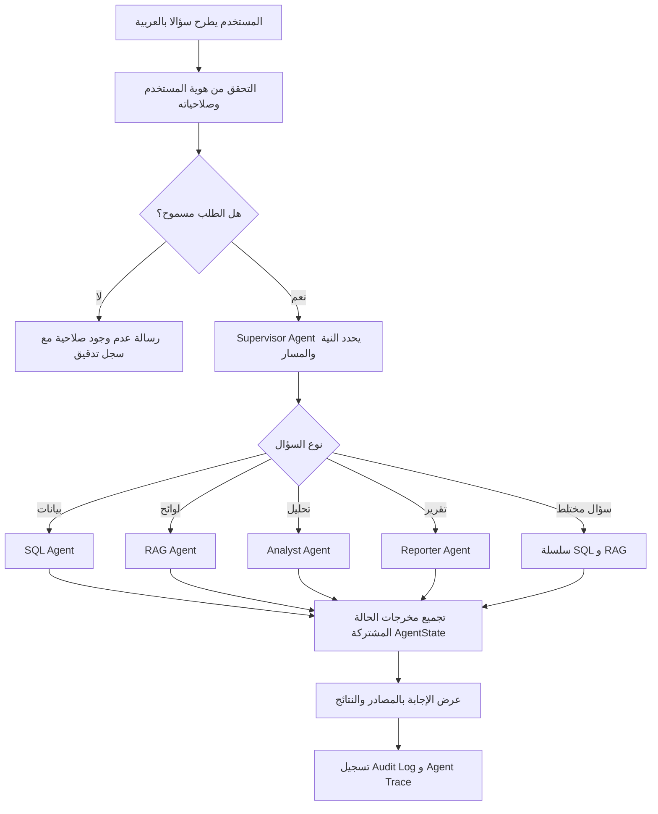
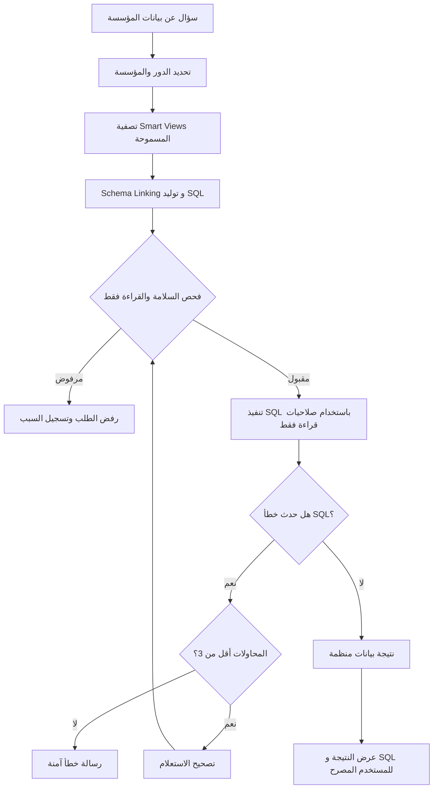
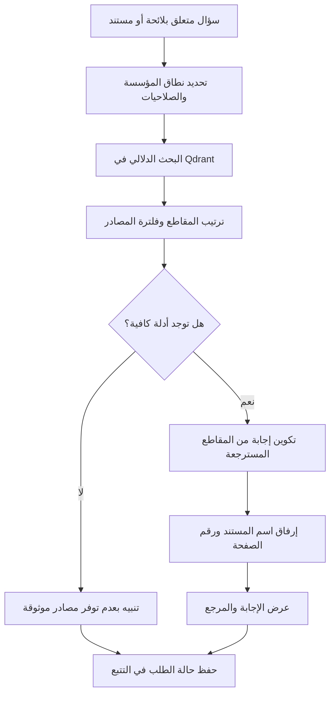
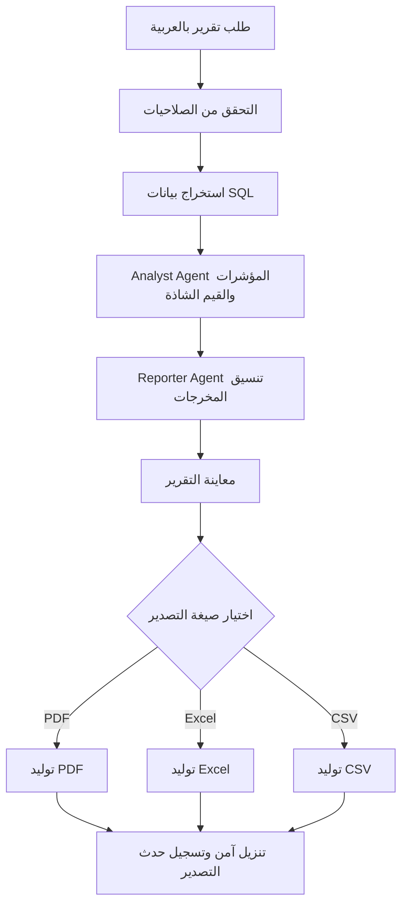
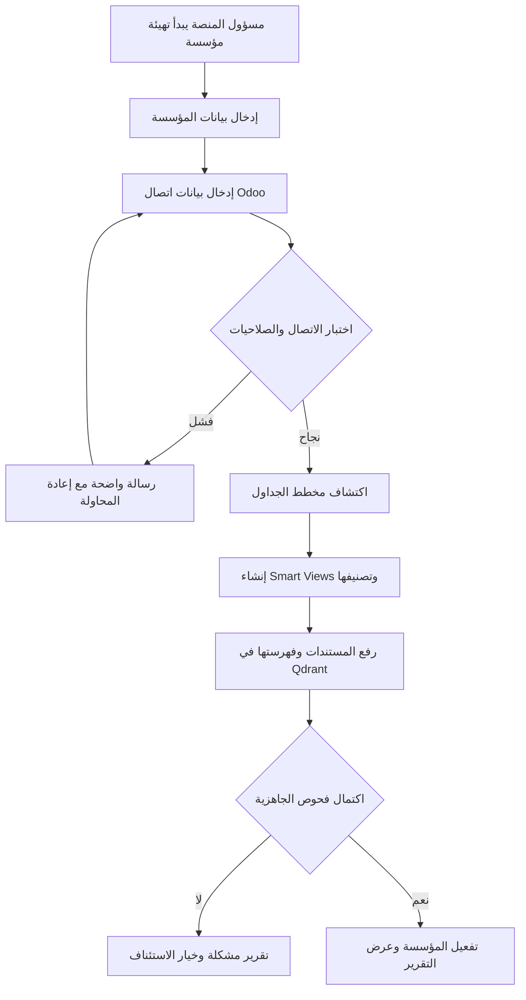
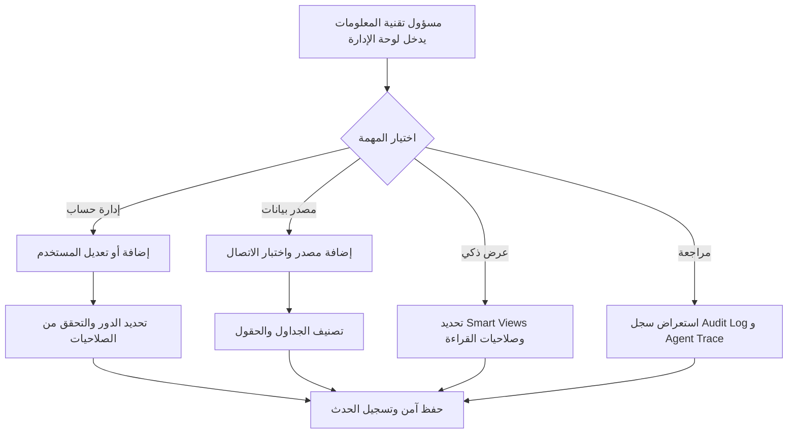
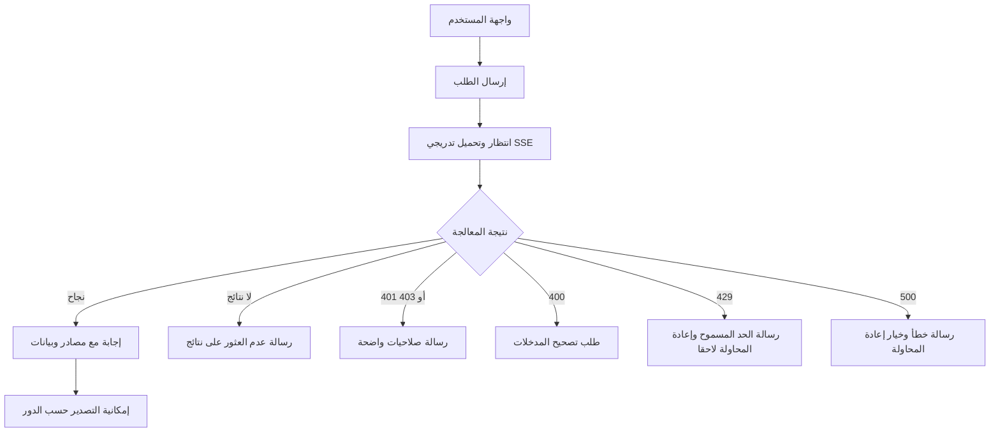

# المخطط الرئيسي لتصميم وتنفيذ واجهات مشروع بيان — Bayan UI/UX Master Plan
**الإصدار:** 1.0 — مخطط تنفيذي أولي | **المرجع الأساسي:** ملف main.pdf (116 صفحة) + النموذج السابق لواجهتي المحادثة والإدارة.

## 1. النطاق وحالة الإنجاز
يرتكز النظام على سبع حالات استخدام موثقة في الفصل الثالث: UC-01 الاستعلام عن البيانات، UC-02 البحث في اللوائح، UC-03 التقارير والتحليل، UC-04 المستخدمون والأدوار، UC-05 مصادر البيانات والتصنيف الأمني، UC-06 التدقيق والتتبع، UC-07 التهيئة الذكية. وتتكون منظومة الوكلاء من Supervisor وSQL وRAG وAnalyst وReporter، وتعمل عبر LangGraph وAgentState. كما تستخدم Smart Views وPostgreSQL وQdrant وOdoo Education في التصميم الموصوف.
**حالة التنفيذ:** الواجهتان الأساسية والإدارية تحاكيان صور التصميم الأصلية. تحتوي حزمة هذا الإصدار على قوالب تفاعلية لجميع المسارات المدرجة أدناه وبيانات تجريبية، لا اتصالات خلفية حقيقية. ينص التكليف الحالي على أن منفذ API حتى الآن هو المحادثة والفحص الصحي؛ لا تُعد بقية الشاشات دليلًا على تنفيذ وظائفها.
**تنبيه توثيقي:** الفصل الرابع في PDF الحالي يحمل عناوين تصميم فقط دون تفاصيل تنفّذ كل هذه الشاشات. لذلك تُعد إضافات الشاشات الفرعية والمودالات وخطة التنفيذ تصميمًا مقترحًا مبنيًا على حالات الاستخدام لا نصًّا من الوثيقة.

## 2. الهوية البصرية وتجربة الاستخدام
- العربية أولًا والاتجاه `dir="rtl"`، مع ضبط اتجاه حقول SQL والإيميل إلى LTR.
- لوحة الألوان المشتقة من التصميمين السابقين: Navy `#0A284E`، Deep Navy `#081F3C`، Turquoise `#079AA5`، خلفيات فاتحة `#F5F9FF`، حدود `#DCE7F4`.
- مكوّنات مشتركة: Header, Sidebar, Breadcrumbs, PageHeader, Table, FilterBar, DetailDrawer, ConfirmationDialog, Toast, Loading/Skeleton, EmptyState, ErrorState, PermissionGate.
- دعم الشاشات الصغيرة، مفاتيح لوحة المفاتيح، التباين، تمييز التركيز، الأيقونات مع النصوص، شاشة فارغة واضحة، وحفظ سياق السؤال.
- منع الادعاء بأن بيانات الواجهات التجريبية بيانات حقيقية؛ جميع الأرقام والأسماء في نموذج الواجهة للتوضيح.

## 3. أدوار الوصول المبدئية
| الوظيفة | موظف | مدير | مسؤول تقنية معلومات | مسؤول منصة |
|---|---:|---:|---:|---:|
| المحادثة والاستعلام اليومي | ✓ | ✓ | حسب السياسة | حسب السياسة |
| البحث في اللوائح | ✓ | ✓ | حسب السياسة | حسب السياسة |
| التقارير والتحليلات | حسب الصلاحية | ✓ | حسب السياسة | حسب السياسة |
| إدارة مستخدمي المؤسسة | — | — | ✓ | حسب التفويض |
| إدارة المصادر والعروض وتصنيفها | — | — | ✓ | حسب التفويض |
| مراجعة التدقيق والتتبع | — | — | ✓ | حسب السياسة |
| تهيئة مؤسسة ومزودي النماذج | — | — | — | ✓ |

**تحذير تنفيذي:** تمثل هذه المصفوفة تقسيمًا أوليًا مستنبطًا من وصف الأدوار في الفصل الثالث، ولا تغني عن مصفوفة RBAC المعتمدة وإجراءات العزل بين المؤسسات على الخادم.

## 4. كتالوج جميع الشاشات ومسارات Next.js
**إجمالي الشاشات في التخطيط: 42**؛ الشاشتان `/` و`/admin` لهما تصميم سابق، وبقية المسارات أضيفت لتصفح الهيكل التجريبي.

| المسار | اسم الشاشة | الأولوية | الأدوار المقترحة | المرجع |
|---|---|:---:|---|---|

### المحادثات — 3 شاشات

| المسار | اسم الشاشة | الأولوية | الأدوار المقترحة | المرجع |
|---|---|:---:|---|---|
| `/` | المحادثة الرئيسية | P0 | موظف المؤسسة، مدير المؤسسة، مسؤول تقنية المعلومات، مسؤول المنصة | UC-01/02 FR-06..18 |
| `/conversations` | المحادثات السابقة | P1 | موظف المؤسسة، مدير المؤسسة، مسؤول تقنية المعلومات، مسؤول المنصة | UC-01/02 |
| `/conversations/details` | تفاصيل المحادثة | P1 | موظف المؤسسة، مدير المؤسسة، مسؤول تقنية المعلومات، مسؤول المنصة | FR-12 |

### الإدارة — 11 شاشات

| المسار | اسم الشاشة | الأولوية | الأدوار المقترحة | المرجع |
|---|---|:---:|---|---|
| `/admin` | لوحة الإدارة الرئيسية | P0 | مسؤول تقنية المعلومات، مسؤول المنصة | UC-04/05/06 |
| `/admin/users` | إدارة المستخدمين | P0 | مسؤول تقنية المعلومات، مسؤول المنصة | UC-04 FR-02 |
| `/admin/users/new` | إضافة مستخدم | P0 | مسؤول تقنية المعلومات، مسؤول المنصة | UC-04 FR-02 |
| `/admin/users/details` | تفاصيل المستخدم | P1 | مسؤول تقنية المعلومات، مسؤول المنصة | UC-04 |
| `/admin/roles` | الأدوار والصلاحيات | P0 | مسؤول تقنية المعلومات، مسؤول المنصة | FR-04 |
| `/admin/data-sources` | مصادر البيانات | P0 | مسؤول تقنية المعلومات، مسؤول المنصة | UC-05 FR-28 |
| `/admin/data-sources/new` | ربط مصدر بيانات | P1 | مسؤول تقنية المعلومات، مسؤول المنصة | UC-05 |
| `/admin/data-sources/details` | تفاصيل مصدر البيانات | P1 | مسؤول تقنية المعلومات، مسؤول المنصة | UC-05 |
| `/admin/smart-views` | العروض الذكية | P0 | مسؤول تقنية المعلومات، مسؤول المنصة | FR-09/10/29 |
| `/admin/smart-views/new` | إنشاء عرض ذكي | P1 | مسؤول تقنية المعلومات، مسؤول المنصة | FR-09/10 |
| `/admin/smart-views/details` | تفاصيل العرض الذكي | P1 | مسؤول تقنية المعلومات، مسؤول المنصة | FR-09/10 |

### الحساب — 5 شاشات

| المسار | اسم الشاشة | الأولوية | الأدوار المقترحة | المرجع |
|---|---|:---:|---|---|
| `/login` | تسجيل الدخول | P0 | موظف المؤسسة، مدير المؤسسة، مسؤول تقنية المعلومات، مسؤول المنصة | FR-01 |
| `/forgot-password` | استعادة الحساب | P2 | موظف المؤسسة، مدير المؤسسة، مسؤول تقنية المعلومات، مسؤول المنصة | FR-03 |
| `/profile` | ملفي الشخصي | P1 | موظف المؤسسة، مدير المؤسسة، مسؤول تقنية المعلومات، مسؤول المنصة | FR-03 |
| `/settings` | تفضيلات الواجهة | P2 | موظف المؤسسة، مدير المؤسسة، مسؤول تقنية المعلومات، مسؤول المنصة | NFR UX |
| `/notifications` | الإشعارات | P2 | موظف المؤسسة، مدير المؤسسة، مسؤول تقنية المعلومات، مسؤول المنصة | UX |

### الوثائق — 4 شاشات

| المسار | اسم الشاشة | الأولوية | الأدوار المقترحة | المرجع |
|---|---|:---:|---|---|
| `/semantic-search` | البحث الدلالي | P0 | موظف المؤسسة، مدير المؤسسة، مسؤول تقنية المعلومات، مسؤول المنصة | UC-02 FR-16..20 |
| `/sources` | مكتبة المستندات واللوائح | P0 | موظف المؤسسة، مدير المؤسسة، مسؤول تقنية المعلومات، مسؤول المنصة | UC-02 |
| `/sources/document` | عارض المستند والمصادر | P1 | موظف المؤسسة، مدير المؤسسة، مسؤول تقنية المعلومات، مسؤول المنصة | FR-18 |
| `/sources/upload` | رفع وفهرسة مستند | P1 | مسؤول تقنية المعلومات، مسؤول المنصة | FR-19 UC-05 |

### التقارير — 3 شاشات

| المسار | اسم الشاشة | الأولوية | الأدوار المقترحة | المرجع |
|---|---|:---:|---|---|
| `/reports` | مركز التقارير | P0 | موظف المؤسسة، مدير المؤسسة، مسؤول تقنية المعلومات، مسؤول المنصة | UC-03 FR-23/24 |
| `/reports/new` | إنشاء تقرير جديد | P1 | مدير المؤسسة | UC-03 |
| `/reports/detail` | معاينة التقرير | P1 | موظف المؤسسة، مدير المؤسسة، مسؤول تقنية المعلومات، مسؤول المنصة | FR-23/24 |

### التحليلات — 2 شاشات

| المسار | اسم الشاشة | الأولوية | الأدوار المقترحة | المرجع |
|---|---|:---:|---|---|
| `/analytics` | لوحة التحليلات | P1 | مدير المؤسسة | FR-21 |
| `/analytics/outliers` | اكتشاف القيم الشاذة | P1 | مدير المؤسسة | FR-22 |

### الرقابة — 4 شاشات

| المسار | اسم الشاشة | الأولوية | الأدوار المقترحة | المرجع |
|---|---|:---:|---|---|
| `/admin/audit` | سجل التدقيق | P0 | مسؤول تقنية المعلومات، مسؤول المنصة | UC-06 FR-05 |
| `/admin/audit/details` | تفاصيل حدث التدقيق | P1 | مسؤول تقنية المعلومات، مسؤول المنصة | UC-06 |
| `/admin/agent-traces` | تتبّع الوكلاء | P1 | مسؤول تقنية المعلومات، مسؤول المنصة | UC-06 FR-12 |
| `/admin/agent-traces/details` | تفاصيل مسار الوكلاء | P1 | مسؤول تقنية المعلومات، مسؤول المنصة | FR-12 |

### المنصة — 7 شاشات

| المسار | اسم الشاشة | الأولوية | الأدوار المقترحة | المرجع |
|---|---|:---:|---|---|
| `/platform/organizations` | المؤسسات المستفيدة | P1 | مسؤول المنصة | UC-07 |
| `/platform/onboarding` | معالج التهيئة الذكية | P0 | مسؤول المنصة | UC-07 FR-28 |
| `/platform/onboarding/history` | سجل عمليات التهيئة | P1 | مسؤول المنصة | UC-07 |
| `/platform/models` | مزودو النماذج اللغوية | P1 | مسؤول المنصة | FR-13 |
| `/platform/agents` | مراقبة الوكلاء | P1 | مسؤول المنصة | FR-27 |
| `/platform/health` | صحة الخدمات | P0 | مسؤول المنصة | Health Check |
| `/platform/settings` | إعدادات المنصة | P1 | مسؤول المنصة | UC-07 |

### النظام — 3 شاشات

| المسار | اسم الشاشة | الأولوية | الأدوار المقترحة | المرجع |
|---|---|:---:|---|---|
| `/forbidden` | غير مصرح بالوصول | P0 | موظف المؤسسة، مدير المؤسسة، مسؤول تقنية المعلومات، مسؤول المنصة | 401/403 |
| `/unavailable` | الخدمة غير متاحة | P1 | موظف المؤسسة، مدير المؤسسة، مسؤول تقنية المعلومات، مسؤول المنصة | NFR Reliability |
| `/screens` | خريطة الواجهات | P0 | موظف المؤسسة، مدير المؤسسة، مسؤول تقنية المعلومات، مسؤول المنصة | Design Planning |

## 5. أنواع الشاشات وتصميم كل واجهة
**أسلوب التطوير:** لكل شاشة (1) هدف واضح، (2) عنوان ومسار، (3) صلاحيات، (4) بيانات وأعمدة أو حقول، (5) حالات تحميل ونجاح وفشل، (6) إجراء أساسي، (7) تصدير/تفاصيل/تأكيد عند الحاجة، (8) اختبار قبول.

### نماذج الشاشات
- **List pages:** جدول + بحث + فلاتر + إجراءات صف + قائمة فارغة + صفحة تفاصيل.
- **Form pages:** حقول محققة + أخطاء لكل حقل + حفظ/إلغاء + تأكيد + منع ازدواج الإرسال.
- **Detail pages:** بيانات وصفية + الصلاحيات + النشاط + إجراء سياقي + عودة.
- **Overview pages:** بطاقات مؤشرات + فلاتر فترة + ملاحظات تحليلية + روابط التفاصيل.
- **Wizard:** تقدم خطوة بخطوة مع فحوص واستئناف عند الفشل (خصوصًا UC-07).
- **Status pages:** 401/403/404/429/500/انقطاع الاتصال، بالعربية وإجراءات مساعدة.

## 6. النوافذ المنبثقة والأدراج
| رقم | النافذة/الدرج | الصفحة المرتبطة | السلوك المطلوب |
|---|---|---|---|
| M01 | محادثة جديدة / تأكيد حذف محادثة | المحادثات | تأكيد آمن |
| M02 | عرض SQL للقراءة فقط | المحادثة | فتح/نسخ وفق الدور |
| M03 | المصادر والاستشهاد | المحادثة/RAG | مستند + رقم صفحة |
| M04 | مسار تنفيذ الوكلاء | المحادثة/التتبعات | Drawer مصرح |
| M05 | تصدير التقرير | المحادثة/التقارير | PDF/Excel/CSV |
| M06 | الإبلاغ عن نتيجة غير دقيقة | المحادثة | حفظ ملاحظة تجريبية |
| M07 | رفع مستند وفحص الامتداد | المصادر | Upload مع حالة تقدم |
| M08 | إضافة مستخدم | الإدارة | Form + تأكيد |
| M09 | تغيير الدور أو تعطيل الحساب | الإدارة | Confirm + سبب |
| M10 | عرض مصفوفة الصلاحيات | الأدوار | View/Filter |
| M11 | اختبار اتصال مصدر البيانات | المصادر المؤسسية | نجاح/فشل |
| M12 | إنشاء/تعديل عرض ذكي | Smart Views | Preview SQL + تصنيف |
| M13 | اختيار تصنيف Public/Masked/Restricted/Blacklist | Smart Views | منع تجاوز السياسة |
| M14 | تفاصيل حدث التدقيق | Audit Log | قراءة فقط |
| M15 | تفاصيل Agent Trace | تتبع الوكلاء | خطوات وتوقيت وأخطاء |
| M16 | تأكيد بدء/إلغاء التهيئة | Onboarding | Confirm |
| M17 | نتائج فهرسة وثيقة | الوثائق/التهيئة | حالة وسبب الفشل |
| M18 | انتهاء الجلسة | الحساب | إعادة تسجيل الدخول |
| M19 | إشعارات النظام | شريط الأدوات | Popover |
| M20 | أخطاء HTTP والاستثناءات | كل الشاشات | 400/401/403/429/500 |

## 7. مخططات تدفق العمل (Flowcharts)
ملفات `.mmd` داخل `docs/flows/` صالحة للتحرير في Mermaid Live أو إضافات VS Code. تتضمن مسارات النجاح والفشل والصلاحيات.

### 01-navigation.mmd


### 02-chat-orchestration.mmd


### 03-nl2sql.mmd


### 04-rag.mmd


### 05-report.mmd


### 06-onboarding.mmd


### 07-admin-security.mmd


### 08-ui-states.mmd


## 8. ترتيب التنفيذ المرحلي
| المرحلة | النطاق | المخرجات ومعايير القبول |
|---|---|---|
| 0 — التحليل والاعتماد | التحقق من المسارات الحالية والكود، قبول قائمة الشاشات ومصفوفة الأدوار | اعتماد الخريطة وعدد الصفحات، عدم خلط المنفذ بالمقترح |
| 1 — Design System | Sidebar, Header, Buttons, Form, Table, Dialog, Toast، RTL | قاعدة مكوّنات واحدة وتجربة متجاوبة |
| 2 — محادثة وRAG | المحادثات، SQL expandable، المصادر، البحث الدلالي، عارض المستند | سؤال تجريبي، عرض الاستشهاد، حالات التحميل والأخطاء |
| 3 — التقارير والتحليلات | التقارير، المعاينة، التصدير، المؤشرات، الشذوذ | تدفق بيانات تجريبية مكتمل وإظهار صلاحية التصدير |
| 4 — إدارة المؤسسة | مستخدمون، أدوار، مصادر بيانات، تصنيف، Smart Views | نماذج محققة، صلاحيات معزولة، جدول وعمليات تأكيد |
| 5 — الرقابة | Audit Log و Agent Trace وتفاصيلهما | فلاتر، تفاصيل، إشارات وصول، سجل أخطاء |
| 6 — إدارة المنصة | مؤسسات، Onboarding، مزودو النماذج، صحة الخدمات | معالج تهيئة قابل للاستئناف بعد الفشل |
| 7 — الربط الخلفي | API Client مع REST/SSE، Auth/RBAC، المخازن والخدمات | عدم الاعتماد على بيانات وهمية خارج وضع Mock |
| 8 — الجودة والإطلاق | اختبارات E2E ووحدات وتجاوب وAccessibility وأمان | قبول UC-01..07 وتوثيق نتائج الاختبار |

## 9. نموذج بيانات الواجهة وعقود API
- **API فعلي:** تثبت أسماؤه الحرفية من مستودع `backend/app/api` قبل كتابة أي عميل HTTP؛ لا تفترض أسماء المسارات.
- **API مقترح:** Auth, Chat/Stream, Reports/Export, Users/Roles, Sources/Smart Views, Audit/Traces, Onboarding/Health.
- **الاستجابات والأخطاء:** `code` ثابت، `message_ar` مفهومة، `developer_details` آمنة ومحجوبة عن المستخدم العادي؛ 400/401/403/429/500.
- **حماية NL2SQL:** واجهات قراءة فقط + تصنيف الجداول الأربعة `Public`, `Masked`, `Restricted`, `Blacklist` كما وردت في الوثيقة؛ لا تقرر الواجهة وحدها الإتاحة.
- **SSE:** بث تدريجي نصيًا عبر الاتصال الأحادي الاتجاه، مع حالات انقطاع الاتصال وإعادة المحاولة وإغلاق التدفق.

## 10. المكونات ومجلد المشروع الأولي
```text
app/
  page.tsx                           ← المحادثة الحالية (مرجع بصري)
  admin/page.tsx                     ← لوحة الإدارة الحالية (مرجع بصري)
  [...slug]/page.tsx                 ← مسارات الشاشات التجريبية الجديدة
  not-found.tsx                      ← 404
components/
  ChatView.tsx                       ← المحادثة الحالية
  AdminDashboard.tsx                 ← لوحة الإدارة الحالية
  FeaturePage.tsx                    ← قالب الواجهات الفرعية التفاعلي
  Sidebar.tsx, TopBar.tsx            ← الهيكل المشترك
lib/
  screen-catalog.json                ← كتالوج الشاشات ومساراتها وأدوارها
app/globals.css                      ← تصميم الواجهتين + أنماط شاشات الإصدار الجديد
docs/
  BAYAN_UI_UX_MASTER_PLAN.md         ← خطة المشروع التفصيلية
  flows/*.mmd                        ← مخططات التدفق القابلة للتحرير
```

بعد اعتماد التصميم تُفصل شاشات الإنتاج من `FeaturePage` إلى وحدات مستقلة في App Router، وتُضاف Server Components وواجهات API وRBAC حقيقي واختبارات. القالب المشترك هنا هو **بداية للتخطيط والتصفح** وليس بديلًا نهائيًا لكل واجهة منفذة.

## 11. قائمة فحص قبول كل شاشة
1. وجود اسم الشاشة ورابط صحيح وسياق مستخدم واضح.
2. وجود واجهة RTL كاملة، وتجنب قلب نصوص SQL والبريد.
3. ظهور Loading وEmpty وError وSuccess حسب الوظيفة.
4. إخفاء البيانات والعمليات المحظورة من الواجهة والتحقق الحقيقي في الخادم.
5. عدم تنفيذ تغييرات حساسة دون تأكيد مناسب وسجل تدقيق.
6. نتائج الاسترجاع مرتبطة بمصدر فعلي ورقم صفحة موثوق.
7. زر التصدير يُظهر الصيغة ويمنع تجاوز صلاحيات الوصول.
8. اختبار كل واجهة على سطح المكتب واللوحي والهاتف ولوحة المفاتيح.
9. التمييز الصريح بين Mock Data وبيانات الإنتاج.
10. ارتباط الشاشة بحالة استخدام أو متطلب وباختبار قبول متوقع.

## 12. الخطوة التنفيذية التالية
اعتماد هذه الخريطة أولًا؛ ثم البدء بـ **المرحلة 1: Design System** وبشاشة تسجيل الدخول والمحادثات وطرق الاسترجاع، ثم ربط المسارات الأصلية بعد فحص كود Backend. النسخة المرافقة توفر تصفحًا تجريبيًا للشاشات جميعها لكنها ليست إنجازًا نهائيًا لكل رحلة عمل.
