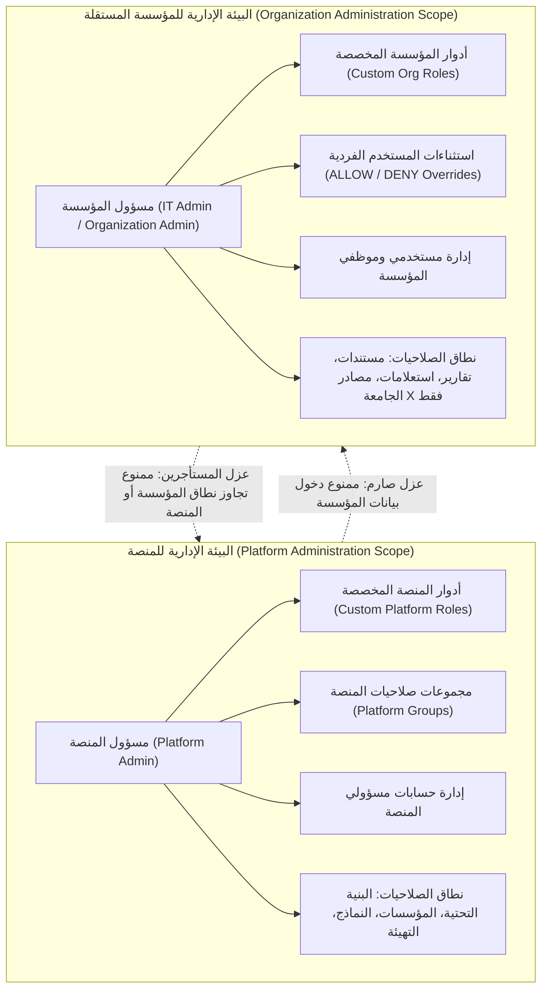
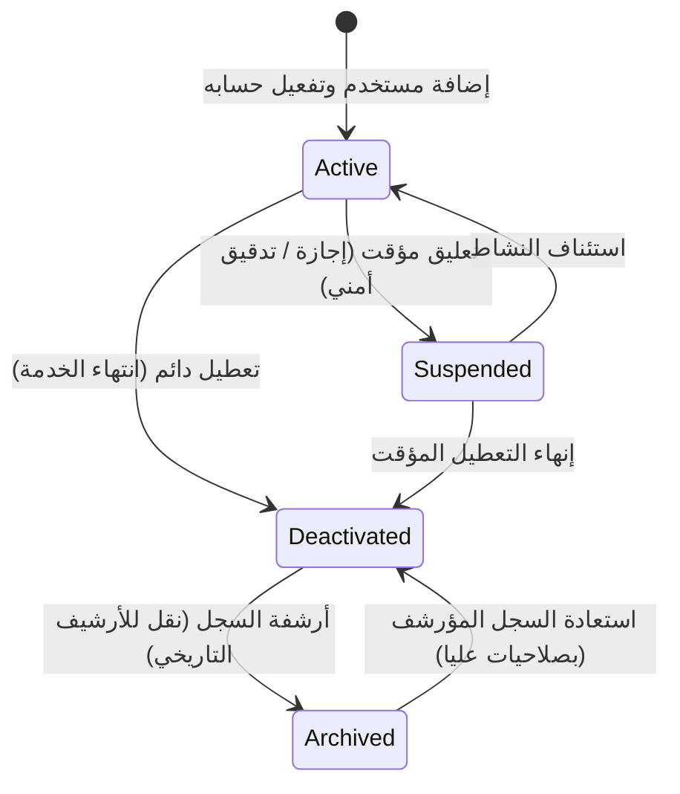
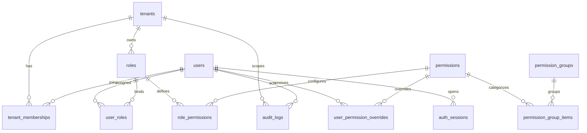
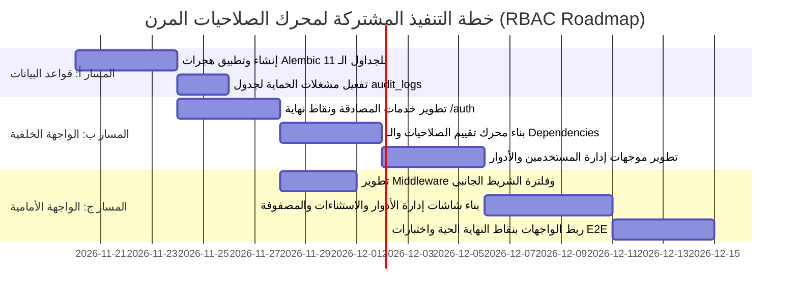

# وثيقة المعمارية الهندسية ومخطط التنفيذ لمحرك الصلاحيات المرن لمؤسسات بيان
# BAYAN ENTERPRISE FLEXIBLE RBAC ENGINE — ARCHITECTURAL BLUEPRINT

**المستودع الرسمي:** `GP-Project-ust/Bayan`  
**الفرع المعتمد:** `Mohammed-Alshareef`  
**النطاق والمسار الوثائقي:** `frontend/docs/FLEXIBLE_RBAC_ARCHITECTURE_BLUEPRINT.md`  
**الحالة:** مواصفة معمارية وتصميمية شاملة — **للمراجعة والاعتماد المسبق (Pre-Implementation Blueprint)**  
**تاريخ الإصدار:** 19 نوفمبر 2026  
**الفريق الهندسي:** استشاري المعمارية، مهندس أمان ونظم الهوية (IAM)، مهندس النظم الخلفية (FastAPI)، مهندس قواعد البيانات (PostgreSQL)، ومهندس جودة النظم (QA).

---

## 1. الملخص التنفيذي ونتائج تدقيق المعمارية الحالية (Current Architecture Audit)

أجرى الفريق تدقيقاً شاملاً ومستقلاً للبنية البرمجية الحالية في الواجهة الأمامية (`frontend/`)، والواجهة الخلفية (`backend/`)، ونظام قواعد البيانات (`database/`)، وخطة التطوير المعتمدة في سجلات القرارات المعمارية (`docs/adr/`).

### أ) واقع الأدوار الأربعة المعتمدة حالياً
يعتمد المشروع في الواجهة الأمامية (`src/lib/access/policy.ts`) أربعة أدوار رئيسية معتمدة تمثل الركائز الهيكلية للمنصة:
1. **`employee` (موظف المؤسسة):** المستخدم العادي، محصور في استعلامات العمل اليومية، البحث في اللوائح المصرح بها، وعرض التقارير المسموحة.
2. **`manager` (مدير المؤسسة):** إدارة الأعمال والعمليات المؤسسية، استعراض وإنشاء وتصدير التقارير، والاطلاع على لوحات التحليلات والقيم الشاذة.
3. **`it_admin` (مسؤول تقنية المعلومات في المؤسسة):** إدارة حسابات المؤسسة، مستخدميها، أدوارها، مصادر بياناتها، العروض الذكية، وسجلات التدقيق الفنية.
4. **`platform_admin` (مسؤول المنصة):** تشغيل البنية التحتية، إدارة المؤسسات المستفيدة، إعداد مزودي النماذج اللغوية (LLMs)، ومراقبة الوكلاء والخدمات.

> **قرار معماري ملزم:** تُحفظ هذه الأدوار الأربعة كنماذج أصلية (**Archetypes / System Roles**) غير قابلة للحذف، دون إضافة دور خامس إلزامي. ويتم فتح المجال لإنشاء أدوار مخصصة ومجموعات صلاحيات مرنة تابعة لها.

### ب) جرد الصلاحيات الحالي (Current Capabilities Inventory)
يحتوي الكود المصدري في `src/lib/access/policy.ts` على 16 صلاحية ذرية (Atomic Capabilities) مقسمة حالياً كالتالي:
* **استعلامات ومستندات:** `chat.ask`، `documents.search`، `citations.view`، `sql.inspect`.
* **تقارير وتحليلات:** `reports.view`، `reports.create`، `reports.export`، `analytics.view`.
* **إدارة المؤسسة:** `users.manage`، `roles.manage`، `sources.manage`، `smartviews.manage`، `audit.view`، `traces.view`.
* **تشغيل المنصة:** `onboarding.run`، `platform.manage`.

### ج) تدقيق المعمارية الحالية للواجهة الخلفية وقواعد البيانات
1. **قواعد البيانات:** تنص وثيقة `docs/01_architecture.md` وملف `backend/app/db/session.py` على وجود قاعدتي بيانات منفصلتين:
   * **قاعدة المنصة (`bayan`):** مخصصة للمحادثات، ذاكرة pgvector، التدقيق، وإعدادات النظام.
   * **قاعدة الجامعة (`university` / Odoo):** بيانات أكاديمية فعلية للقراءة فقط عبر المستخدم المقيد `bayan_reader`.
2. **الفجوة المعمارية المرصودة (Identified Gaps):**
   * **غياب جداول الهوية والصلاحيات في PostgreSQL:** لا توجد حالياً أي جداول في قاعدة المنصة لإدارة المستخدمين (`users`)، الأدوار (`roles`)، الصلاحيات (`permissions`)، أو الجلسات (`sessions`).
   * **غياب المصادقة وإدارة الجلسات في FastAPI:** الموجه `backend/app/api/v1/router.py` يحتوي فقط على نقاط نهاية `health` و `chat` و `stream`، ويفتقر إلى موجهات المصادقة (`/api/v1/auth/login`, `/me`).
   * **اعتماد الواجهة الأمامية على المحاكاة:** شاشات إدارة المستخدمين (`src/components/user-management/`) والأدوار (`src/components/roles-permissions/`) تعتمد بالكامل على مصفوفات وهمية في الذاكرة وتخزين محلي `localStorage`.
   * **جمود الصلاحيات:** الصلاحيات الحالية ثابتة في كود TypeScript (`rolePermissions`)، ولا تتيح التخصيص لكل مستخدم أو إضافة استثناءات صريحة (ALLOW / DENY) أو إنشاء أدوار فرعية.

---

## 2. معمارية الصلاحيات المرنة المقترحة (Flexible Enterprise RBAC Architecture)

تهدف هذه المعمارية إلى تحويل نظام الصلاحيات من مصفوفة عرض ثابتة إلى **محرك صلاحيات مؤسسي ديناميكي (Dynamic Enterprise RBAC Engine)** يعمل عبر بيئتين إداريتين مستقلتين تماماً:



### أ) البيئة الأولى: إدارة صلاحيات المنصة (Platform Administration)
نظام مستقل يدير عمليات المنصة المشتركة ويخضع لضوابط تفويض دقيقة:
1. **تعدد مسؤولي المنصة بمسؤوليات مختلفة:** لا يمتلك كل مسؤول منصة وصولاً مطلقاً لكافة الخصائص؛ بل يتم توزيع المهام حسب مجموعات الصلاحيات:
   * **مجموعة إدارة البنية التحتية (Infrastructure Ops):** مراقبة صحة الخوادم، الاتصال بقواعد البيانات، وحدود الذاكرة.
   * **مجموعة إدارة مزودي الذكاء الاصطناعي (AI Providers Ops):** ربط خوادم Ollama، مفاتيح النماذج اللغوية، واختبار نماذج التضمين (BGE-M3).
   * **مجموعة تهيئة المستأجرين (Tenant Onboarding):** إنشاء المؤسسات الجديدة، تشغيل معالج التهيئة، وربط مصادر البيانات الجامعية.
   * **مجموعة إدارة مسؤولي المنصة (Platform User Ops):** إنشاء حسابات مسؤولي المنصة الآخرين وتحديد أدوارهم.
   * **مجموعة تدقيق المنصة (Platform Audit Ops):** مراجعة سجلات التدقيق المركزية ومسارات الوكلاء الشاملة.
2. **حدود التفويض ومنع التصعيد الذاتي (Anti-Privilege Escalation):**
   * لا يمكن لمسؤول منصة منح نفسه أو غيره صلاحية لا يمتلكها هو شخصياً.
   * لا يمكن لمسؤول منصة تفويض صلاحية إلا إذا كان يمتلك حق تفويضها صراحة (`*.delegate`).
   * **تهيئة المسؤول الأول (Bootstrap Root Admin):** يتم إنشاء أول حساب مسؤول منصة موثوق عبر أمر سطر أوامر آمن ومشفر من الخادم الخلفي (`python -m app.cli.create_initial_admin`) أثناء التثبيت الأولي للنظام في بيئة معزولة، دون الحاجة لدور خامس.

### ب) البيئة الثانية: إدارة صلاحيات المؤسسة (Organization Administration)
بيئة إدارة ذاتية مستقلة لكل مؤسسة مستفيدة (Multi-Tenant Isolation):
1. **الاستقلالية التامة:** يمتلك مدير تقنية المعلومات (`it_admin`) أو المفوضون في المؤسسة السيطرة الكاملة على:
   * إنشاء وتعديل وتعطيل حسابات الموظفين والمديرين داخل مؤسستهم حصراً.
   * إنشاء أدوار مخصصة تلائم الهيكل الجامعي (مثل: "مسجل كلية الهندسة"، "رئيس قسم المالية"، "مدقق جودة").
   * إسناد أدوار متعددة للمستخدم الواحد مع دمج الصلاحيات.
   * تطبيق استثناءات فردية مخصصة لمستخدم بعينه (Override) تتجاوز إعدادات الدور الأصلي (منح مؤقت أو حجب مقصود).
2. **العزل التام بين المؤسسات:**
   * عزل كامل على مستوى الصفوف وقاعدة البيانات؛ مستندات ومحادثات ومستخدمو "جامعة العلوم والتكنولوجيا" محجوبة تماماً عن أي جامعة أو مؤسسة أخرى.
   * لا يمكن لمسؤول المؤسسة الاطلاع على مسؤولي المنصة أو تعديل إعداداتها العامة.

---

## 3. محرك الصلاحيات وخوارزمية التقييم القطعية (Permission Engine & Evaluation Algorithm)

يعتمد المحرك على نموذج هجين متقدم: **RBAC ممتد باستثناءات المستخدم الصريحة (RBAC with Explicit Overrides)** لضمان المرونة الكاملة دون فقدان الأمان القطعي.

### أ) مراتب التقييم وقواعد الحسم (Precedence Hierarchy)

```
[ المرتبة 0: فحص نطاق المستأجر (Tenant Scope Check) ]
    ├─ إذا كان المسار يخص مؤسسة أ والطلب قادم لمؤسسة ب ───────► [ رفض فوري: 403 DENY ]
    └─ إذا كان الطلب يخص المنصة والفاعل لا يملك نطاق المنصة ─────► [ رفض فوري: 403 DENY ]

[ المرتبة 1: الاستثناء الفردي بالحجب الصريح (Explicit User DENY) ]
    └─ إذا وُجد استثناء حجب صريح للمستخدم على الصلاحية ────────► [ رفض فوري: DENY ]

[ المرتبة 2: الاستثناء الفردي بالمنح الصريح (Explicit User ALLOW) ]
    └─ إذا وُجد استثناء منح صريح للمستخدم وكان ساري المفعول ────► [ قبول فوري: ALLOW ]

[ المرتبة 3: تقييم الأدوار الموروثة (Inherited Active Roles) ]
    ├─ إذا كان أي دور للمستخدم يحتوي على حجب صريح (Role DENY) ──► [ رفض: DENY ]
    └─ إذا كان أي دور للمستخدم يحتوي على منح (Role ALLOW) ───────► [ قبول: ALLOW ]

[ المرتبة 4: القاعدة الافتراضية الصارمة (Default Implicit DENY) ]
    └─ في حال عدم انطباق أي مما سبق (Zero Trust Policy) ────────► [ رفض حتمي: DENY ]
```

### ب) الصيغة الرياضية والمنطقية للتقييم القطعي
يُعرّف القرار النهائي لصلاحية $C$ للمستخدم $U$ في المؤسسة $T$ كالتالي:

$$\text{Decision}(U, T, C) = 
\begin{cases} 
\text{DENY} & \text{if } \text{ScopeMismatch}(U, T) \\
\text{DENY} & \text{if } \text{UserOverride}(U, C) = \text{DENY} \\
\text{ALLOW} & \text{if } \text{UserOverride}(U, C) = \text{ALLOW} \land \text{NotExpired}(U, C) \\
\text{DENY} & \text{if } \exists R \in \text{Roles}(U): \text{RolePermission}(R, C) = \text{DENY} \\
\text{ALLOW} & \text{if } \exists R \in \text{Roles}(U): \text{RolePermission}(R, C) = \text{ALLOW} \\
\text{DENY} & \text{otherwise (Implicit Default)}
\end{cases}$$

### ج) قواعد إلغاء الاستثناءات (Override Removal)
* عند قيام المسؤول بحذف استثناء فردي (Remove Override)، **يعود المستخدم فوراً إلى سلوك التوريث الطبيعي للأدوار المسندة إليه**.
* لا يؤدي حذف الاستثناء إلى مسح سجلات التدقيق التاريخية الخاصة بمنحه أو إلغائه، بل يُسجل حدث "إلغاء الاستثناء واستعادة التوريث" كعملية جديدة غير قابلة للمسح.

### د) ضوابط التفويض ومنع تصعيد الامتيازات
1. **مبدأ الحيازة:** لا يمكن لأي مستخدم منح صلاحية إلا إذا كان يمتلكها بالفعل.
2. **مبدأ راية التفويض (`delegatable: true`):** يجب أن تكون الصلاحية لدى المسؤول قابلة للتفويض للغير.
3. **منع التعديل الذاتي:** يُمنع المسؤول منعاً باتاً من تعديل أدواره أو استثناءاته الشخصية لتجنب قفل الحساب أو تصعيد الامتيازات الذاتية دون موافقة مسؤول آخر.

---

## 4. دورة حياة المستخدمين والأدوار والتعافي الإداري (User & Role Lifecycle)

### أ) حالات المستخدمين في النظام



1. **التعليق (`Suspended`):** تجميد وصول المستخدم مؤقتاً؛ تُرفض جلساته الحالية فوراً، مع الاحتفاظ بجميع أدواره واستثناءاته كما هي لاستعادتها فور رفع التعليق.
2. **التعطيل (`Deactivated`):** إلغاء وصول المستخدم نهائياً، مع إلغاء كل الجلسات النشطة.
3. **الأرشفة (`Archived`):** إخفاء المستخدم من القوائم النشطة ونقله لسجلات الأرشفة لحفظ البيانات التاريخية للمحادثات والتقارير التي أنشأها، وفقاً لمتطلبات الامتثال والرقابة.
4. **الحذف الفيزيائي الدائم (`Hard Delete`):** **محظور أمنياً وقانونياً**. لا يتم حذف سجل المستخدم أو التدقيق نهائياً من قاعدة البيانات لحماية سلامة العلاقات المرجعية للبيانات المؤسسية وسجلات التدقيق التاريخية.

### ب) حماية النظام من القفل الإداري والتعافي الآمن (Anti-Lockout & Break-Glass)
* **قاعدة منع القفل الذاتي (Anti-Lockout Invariant):**
  يمنع محرك الصلاحيات في الواجهة الخلفية تنفيذ أي عملية تؤدي إلى:
  1. تعطيل، أو أرشفة، أو حذف دور آخر مسؤول نشط (`it_admin`) في المؤسسة.
  2. سحب صلاحية إدارة المستخدمين أو الأدوار من آخر مسؤول يمتلكها.
  3. تعطيل آخر مسؤول منصة نشط (`platform_admin`).
* **إجراء التعافي عند الطوارئ (Break-Glass Recovery Procedure):**
  في حال فقدان بيانات الدخول لجميع المسؤولين أو حدوث عطل إداري، يوفر النظام إجراء تعافٍ معزولاً عبر سطر أوامر الخادم المباشر (CLI) يتطلب وصولاً مادياً أو عبر SSH إلى الخادم، ويقوم بتوليد مفتاح تعافٍ لمرة واحدة (One-Time Emergency Access Key) يُسجل فوراً في سجل التدقيق غير القابل للتعديل.

---

## 5. مخطط قاعدة البيانات ومقترح الهجرات (Database Schema & Migration Proposal)

تصميم شامل ومحكم لـ **11 جدولاً** في قاعدة بيانات المنصة (`bayan`) يدعم التعددية المؤسسية والعزل الصارم وتتبع العمليات:



### تفاصيل الجداول الـ 11 المقترحة:

#### 1. جدول المؤسسات (`tenants`)
* **الغرض:** تسجيل المؤسسات والجامعات المستفيدة من المنصة.
* **الحقول:**
  * `id`: `UUID` (مفتاح أساسي).
  * `code`: `VARCHAR(50)` (فريد، مثل `ust-yemen`).
  * `name_ar`: `VARCHAR(255)` (اسم المؤسسة بالعربية).
  * `status`: `VARCHAR(30)` (`active`, `suspended`, `onboarding`).
  * `created_at`: `TIMESTAMPTZ` (تاريخ الإنشاء).
  * `updated_at`: `TIMESTAMPTZ`.

#### 2. جدول المستخدمين الأساسي (`users`)
* **الغرض:** الهوية الموحدة للمستخدم (بيانات الاعتماد والملف الشخصي).
* **الحقول:**
  * `id`: `UUID` (مفتاح أساسي).
  * `email`: `VARCHAR(255)` (فريد ومفهرس).
  * `hashed_password`: `VARCHAR(255)` (تجزئة Argon2id/Bcrypt).
  * `full_name`: `VARCHAR(255)`.
  * `phone`: `VARCHAR(50)`.
  * `is_platform_admin`: `BOOLEAN` (افتراضياً `false`).
  * `status`: `VARCHAR(30)` (`active`, `suspended`, `deactivated`, `archived`).
  * `created_at`: `TIMESTAMPTZ`.
  * `updated_at`: `TIMESTAMPTZ`.

#### 3. جدول انتماءات المؤسسة (`tenant_memberships`)
* **الغرض:** ربط المستخدم بالمؤسسات التي ينتمي إليها وعزل بياناته.
* **الحقول:**
  * `id`: `UUID` (مفتاح أساسي).
  * `tenant_id`: `UUID` (FK -> `tenants.id` على مسار الـ Cascade).
  * `user_id`: `UUID` (FK -> `users.id` على مسار الـ Cascade).
  * `department`: `VARCHAR(100)` (القسم/الكلية التابع لها).
  * `status`: `VARCHAR(30)` (`active`, `suspended`, `deactivated`).
  * `joined_at`: `TIMESTAMPTZ`.
  * **القيود:** قيد فريد مركب `UNIQUE (tenant_id, user_id)`.

#### 4. جدول الأدوار (`roles`)
* **الغرض:** حفظ الأدوار النظامية المدمجة والأدوار المخصصة للمؤسسة أو المنصة.
* **الحقول:**
  * `id`: `UUID` (مفتاح أساسي).
  * `tenant_id`: `UUID` (FK -> `tenants.id`، يقبل `NULL` للأدوار الشاملة وأدوار المنصة).
  * `name_code`: `VARCHAR(100)` (الاسم الرمزي مثل `academic_dean`).
  * `name_ar`: `VARCHAR(255)` (الاسم العربي الظاهر).
  * `description_ar`: `TEXT`.
  * `scope`: `VARCHAR(30)` (`organization`, `platform`).
  * `is_system_role`: `BOOLEAN` (افتراضياً `false`؛ `true` للأدوار الأربعة الأساسية لمنع حذفها).
  * `created_at`: `TIMESTAMPTZ`.
  * **القيود:** `UNIQUE (tenant_id, name_code)`.

#### 5. جدول إسناد الأدوار للمستخدمين (`user_roles`)
* **الغرض:** ربط المستخدم بدور أو أكثر داخل نطاق معين.
* **الحقول:**
  * `id`: `UUID` (مفتاح أساسي).
  * `user_id`: `UUID` (FK -> `users.id`).
  * `role_id`: `UUID` (FK -> `roles.id`).
  * `tenant_id`: `UUID` (FK -> `tenants.id`، يقبل `NULL` لأدوار المنصة).
  * `assigned_by`: `UUID` (FK -> `users.id`).
  * `assigned_at`: `TIMESTAMPTZ`.
  * **القيود:** `UNIQUE (user_id, role_id, tenant_id)`.

#### 6. جدول الصلاحيات الذرية (`permissions`)
* **الغرض:** الكتالوج المعتمد لجميع الصلاحيات الذرية المتاحة في النظام.
* **الحقول:**
  * `id`: `UUID` (مفتاح أساسي).
  * `code`: `VARCHAR(100)` (فريد ومفهرس، مثل `reports.export`).
  * `name_ar`: `VARCHAR(255)` (الاسم العربي مثل "تصدير التقارير").
  * `description_ar`: `TEXT`.
  * `scope`: `VARCHAR(30)` (`organization`, `platform`, `shared`).
  * `is_delegatable_by_default`: `BOOLEAN`.

#### 7. جدول مجموعات الصلاحيات (`permission_groups`)
* **الغرض:** تجميع الصلاحيات في حزم وظيفية (مثل حزمة "إدارة شؤون الطلاب").
* **الحقول:**
  * `id`: `UUID` (مفتاح أساسي).
  * `tenant_id`: `UUID` (يقبل `NULL` للمجموعات القياسية العامة).
  * `name_ar`: `VARCHAR(255)`.
  * `scope`: `VARCHAR(30)`.

#### 8. جدول بنود مجموعات الصلاحيات (`permission_group_items`)
* **الحقول:** `group_id` (FK)، `permission_id` (FK). `PK (group_id, permission_id)`.

#### 9. جدول صلاحيات الأدوار (`role_permissions`)
* **الغرض:** ربط الأدوار بالصلاحيات مع تحديد نوع الإجراء.
* **الحقول:**
  * `id`: `UUID` (مفتاح أساسي).
  * `role_id`: `UUID` (FK -> `roles.id`).
  * `permission_id`: `UUID` (FK -> `permissions.id`).
  * `effect`: `VARCHAR(10)` (`ALLOW`, `DENY`).
  * **القيود:** `UNIQUE (role_id, permission_id)`.

#### 10. جدول استثناءات الصلاحيات للمستخدم (`user_permission_overrides`)
* **الغرض:** تسجيل المنح أو الحجب الفردي لمستخدم معين متجاوزاً أدواره.
* **الحقول:**
  * `id`: `UUID` (مفتاح أساسي).
  * `user_id`: `UUID` (FK -> `users.id`).
  * `tenant_id`: `UUID` (FK -> `tenants.id`، يقبل `NULL` لمسؤولي المنصة).
  * `permission_id`: `UUID` (FK -> `permissions.id`).
  * `effect`: `VARCHAR(10)` (`ALLOW`, `DENY`).
  * `reason`: `TEXT` (سبب المنح/الحجب الإلزامي لضمان الامتثال).
  * `granted_by`: `UUID` (FK -> `users.id`).
  * `expires_at`: `TIMESTAMPTZ` (تاريخ انتهاء اختياري للصلاحيات المؤقتة).
  * `created_at`: `TIMESTAMPTZ`.
  * **القيود:** `UNIQUE (user_id, tenant_id, permission_id)`.

#### 11. جدول جلسات المصادقة الآمنة (`auth_sessions`)
* **الغرض:** تتبع الجلسات النشطة في الواجهة الخلفية وتمكين الإلغاء الفوري.
* **الحقول:**
  * `id`: `UUID` (مفتاح أساسي).
  * `session_token_hash`: `VARCHAR(255)` (تجزئة SHA-256 للرمز).
  * `user_id`: `UUID` (FK -> `users.id`).
  * `active_tenant_id`: `UUID` (المؤسسة النشطة حالياً للجلسة).
  * `ip_address`: `VARCHAR(45)`.
  * `user_agent`: `TEXT`.
  * `expires_at`: `TIMESTAMPTZ`.
  * `revoked_at`: `TIMESTAMPTZ` (يقبل `NULL`).
  * `created_at`: `TIMESTAMPTZ`.

#### 12. جدول سجل تدقيق الصلاحيات والوصول (`audit_logs`)
* **الغرض:** سجل تدقيق أمني غير قابل للتعديل أو الحذف (Append-Only).
* **الحقول:**
  * `id`: `BIGSERIAL` (مفتاح أساسي متسلسل).
  * `tenant_id`: `UUID` (يقبل `NULL` لعمليات المنصة العامة).
  * `actor_id`: `UUID` (المستخدم المنفذ للعملية).
  * `target_user_id`: `UUID` (المستخدم المتأثر، اختياري).
  * `target_role_id`: `UUID` (الدور المتأثر، اختياري).
  * `operation`: `VARCHAR(100)` (مثل `USER_ROLE_ASSIGNED`, `OVERRIDE_GRANTED`).
  * `permission_code`: `VARCHAR(100)`.
  * `previous_state`: `JSONB` (الحالة السابقة للبيانات).
  * `new_state`: `JSONB` (الحالة الجديدة بعد التعديل).
  * `reason`: `TEXT` (المبرر الإداري المسجل).
  * `request_id`: `VARCHAR(100)` (معرف التتبع المشترك).
  * `ip_address`: `VARCHAR(45)`.
  * `created_at`: `TIMESTAMPTZ` (تاريخ وتسجيل العملية).
* **إجراء الحماية الصارم (Immutability):**
  إنشاء تريجر (PostgreSQL Trigger) يرفض رفضاً قاطعاً أي استعلام `UPDATE` أو `DELETE` على هذا الجدول.

---

## 6. عقود واجهات برمجة التطبيقات في FastAPI (Backend API Contracts)

جدول تفصيلي لنقاط النهاية (Endpoints) المطلوبة لإدارة الصلاحيات والمستخدمين:

| الطريقة | المسار (URL) | الوظيفة | الصلاحية المطلوبة | نطاق التحقق (Scope) |
| :--- | :--- | :--- | :--- | :--- |
| `POST` | `/api/v1/auth/login` | تسجيل الدخول وإصدار HttpOnly Cookie | عام | فحص الاعتماد وحالة الحساب |
| `POST` | `/api/v1/auth/logout` | إبطال الجلسة وحذف الكوكي | مصادق | إنهاء جلسة السيرفر |
| `GET` | `/api/v1/auth/me` | استرجاع هوية المستخدم ومصفوفة صلاحياته الفعالة | مصادق | حسب المؤسسة النشطة |
| `GET` | `/api/v1/orgs/{org_id}/users` | قائمة مستخدمي المؤسسة مع التصفية والفرز | `users.view` / `users.manage` | مطابقة `tenant_id` |
| `POST` | `/api/v1/orgs/{org_id}/users` | إنشاء مستخدم جديد داخل المؤسسة | `users.manage` | مطابقة `tenant_id` |
| `GET` | `/api/v1/orgs/{org_id}/users/{user_id}` | تفاصيل مستخدم وأدواره واستثناءاته | `users.view` / `users.manage` | مطابقة `tenant_id` |
| `PATCH` | `/api/v1/orgs/{org_id}/users/{user_id}/status` | تنشيط أو تعليق أو تعطيل الحساب | `users.manage` | فحص منع القفل الذاتي |
| `GET` | `/api/v1/orgs/{org_id}/roles` | استعراض أدوار المؤسسة (المدمجة والمخصصة) | `roles.view` / `roles.manage` | مطابقة `tenant_id` |
| `POST` | `/api/v1/orgs/{org_id}/roles` | إنشاء دور مخصص جديد لمؤسسة | `roles.manage` | مطابقة `tenant_id` |
| `PUT` | `/api/v1/orgs/{org_id}/roles/{role_id}` | تعديل صلاحيات الدور المخصص | `roles.manage` | منع تعديل الأدوار المدمجة |
| `DELETE`| `/api/v1/orgs/{org_id}/roles/{role_id}` | حذف دور مخصص (غير مسند لمستخدمين) | `roles.manage` | منع حذف الأدوار المدمجة |
| `POST` | `/api/v1/orgs/{org_id}/users/{user_id}/roles` | إسناد دور للمستخدم داخل المؤسسة | `roles.manage` | فحص حيازة الصلاحيات |
| `POST` | `/api/v1/orgs/{org_id}/users/{user_id}/overrides` | إضافة استثناء فردي (ALLOW / DENY) | `roles.manage` + تفويض | إلزام ذكر السبب والمبرر |
| `DELETE`| `/api/v1/orgs/{org_id}/users/{user_id}/overrides/{perm_id}` | إزالة الاستثناء واستعادة التوريث | `roles.manage` | مطابقة `tenant_id` |
| `GET` | `/api/v1/platform/admins` | استعراض قائمة مسؤولي المنصة | `platform.manage` | نطاق المنصة فقط |
| `POST` | `/api/v1/platform/admins` | إنشاء حساب مسؤول منصة جديد وتعيين صلاحياته | `platform.manage` | نطاق المنصة فقط |
| `GET` | `/api/v1/permissions/catalog` | كتالوج الصلاحيات الذرية ومجموعاتها | مصادق | مرشح حسب النطاق |
| `GET` | `/api/v1/audit/permissions` | استعلام سجل تدقيق الصلاحيات والوصول | `audit.view` | فلترة حسب النطاق والمؤسسة |

### نموذج مخطط الطلب والاستجابة (Schema Specification):

#### استثناء الصلاحية الفردي: `POST /api/v1/orgs/{org_id}/users/{user_id}/overrides`
```json
// Request Payload:
{
  "permission_code": "reports.export",
  "effect": "ALLOW",
  "reason": "تكليف رسمي من العميد برئاسة لجنة الجودة للفصل الثاني 2026",
  "expires_at": "2026-06-30T23:59:59Z"
}

// Response (201 Created):
{
  "override_id": "8f3b6c2a-9e12-4c8d-8a5e-3c2b1a9f0e4d",
  "user_id": "4b2c1d0e-7f8a-4c9b-9a1d-2e3f4a5b6c7d",
  "permission_code": "reports.export",
  "effect": "ALLOW",
  "inherited_effect": "DENY",
  "effective_effect": "ALLOW",
  "reason": "تكليف رسمي من العميد برئاسة لجنة الجودة للفصل الثاني 2026",
  "granted_by": "1a2b3c4d-5e6f-7a8b-9c0d-1e2f3a4b5c6d",
  "created_at": "2026-11-19T04:15:00Z"
}
```

---

## 7. هندسة واجهات المستخدم وتصميم الشاشات (Frontend UI/UX Specification)

إعادة استخدام وتوسيع نظام تصميم بيان الحالي (`bayan-ui`, Tailwind, Lucide Icons, RTL Arabic) دون الحاجة لإعادة تصميم المنصة من الصفر:

### أ) شاشات إدارة المؤسسة (14 شاشة ومشهداً فرعياً)
1. **لوحة مستخدمي المؤسسة (`/admin/users`):** مؤشرات إحصائية للحسابات النشطة، توزيع الأدوار، وإجراءات سريعة للإضافة والتصدير.
2. **جدول المستخدمين المتقدم (`/admin/users` - Table View):** تصفية حسب القسم، الدور، والحالة، مع بحث بالاسم والبريد.
3. **إضافة مستخدم جديد (`/admin/users/new`):** استمارة إدخال بيانات المستخدم وتعيين دوره الأولي والقسم التابع له.
4. **تعديل بيانات المستخدم (`/admin/users/[id]/edit`):** تحديث الاسم، القسم، والهاتف، وإعادة تعيين كلمة المرور.
5. **تفاصيل المستخدم الشاملة (`/admin/users/[id]`):** بطاقة الهوية، الأدوار المسندة، ملخص الصلاحيات الموروثة والاستثناءات.
6. **إدارة أدوار المؤسسة (`/admin/roles`):** استعراض بطاقات الأدوار الأربعة الأصلية والأدوار المخصصة الجديدة.
7. **إنشاء دور مخصص (`/admin/roles/new`):** تحديد اسم الدور بالعربية، رمزه، واختيار الصلاحيات المرتبطة به.
8. **تعديل الدور المخصص (`/admin/roles/[id]/edit`):** إضافة أو سحب الصلاحيات من الدور المخصص وتعديل وصفه.
9. **مصفوفة صلاحيات الأدوار (`/admin/roles/matrix`):** جدول متكامل يقارن صلاحيات الأدوار المختلفة مجمعة وظيفياً.
10. **إدارة استثناءات المستخدم الفردي (`/admin/users/[id]/permissions`):** شاشة مخصصة لإضافة أو حذف الـ Overrides مع بيان السبب.
11. **مجموعات الصلاحيات للمؤسسة (`/admin/roles/groups`):** إدارة الحزم الوظيفية لتسهيل إسناد الصلاحيات الشائعة.
12. **سجل نشاط وصلاحيات المستخدم (`/admin/users/[id]/history`):** عرض زمني لكافة التعديلات التي طرأت على صلاحيات المستخدم وأدواره.
13. **سجل تدقيق المؤسسة (`/admin/audit`):** استعراض جدول التدقيق مع البحث والتصفية حسب الفاعل، نوع العملية، والتاريخ.
14. **شاشة حجب الوصول (`/forbidden`):** واجهة ودية توضح سبب حجب الصفحة مع زر للعودة للرئيسية والتواصل مع الدعم الفني.

### ب) شاشات إدارة المنصة (10 شاشات ومشهداً فرعياً)
1. **لوحة معلومات صلاحيات المنصة (`/platform/permissions`):** نظرة عامة على مسؤولي المنصة وصحة الخدمات الحساسة.
2. **قائمة مسؤولي المنصة (`/platform/admins`):** استعراض مسؤولي المنصة الحاليين ومجموعات صلاحياتهم.
3. **إضافة مسؤول منصة (`/platform/admins/new`):** نموذج تسجيل مسؤول منصة وتحديد نطاق مسؤولياته دون منحه وصولاً مطلقاً.
4. **تعديل صلاحيات مسؤول المنصة (`/platform/admins/[id]/edit`):** تحديث مجموعات الصلاحيات المسندة لمسؤول المنصة.
5. **إدارة أدوار المنصة التشغيلية (`/platform/roles`):** تنظيم أدوار المنصة (مثل: "مسؤول ذكاء اصطناعي"، "مشغل بنية تحتية").
6. **مجموعات صلاحيات المنصة (`/platform/permission-groups`):** تكوين حزم صلاحيات موجهة لفرق التشغيل.
7. **مصفوفة صلاحيات المنصة (`/platform/roles/matrix`):** مصفوفة المقارنة التفاعلية لأدوار تشغيل المنصة.
8. **استثناءات مسؤولي المنصة (`/platform/admins/[id]/permissions`):** إدارة الاستثناءات الفردية الدقيقة لمسؤولي المنصة.
9. **سجل تدقيق عمليات المنصة (`/platform/audit`):** سجل التدقيق المركزي لعمليات البنية والتهيئة والذكاء الاصطناعي.
10. **شاشة منع الوصول لعمليات المنصة (`/platform/forbidden`):** واجهة مخصصة لحجب العمليات الحساسة في المنصة.

### ج) واجهة مصفوفة الصلاحيات المجمعة (Grouped Matrix Component)
تصميم مكون المصفوفة التفاعلي (`src/components/access/PermissionMatrix.tsx`):
* **التصنيفات الوظيفية للمصفوفة:**
  1. الاستعلامات والمحادثات الذكية.
  2. مصادر البيانات والمستندات.
  3. التقارير والمؤشرات الأكاديمية.
  4. التحليلات واكتشاف القيم الشاذة.
  5. العروض الذكية (Smart Views).
  6. إدارة حسابات ومستخدمي المؤسسة.
  7. الأدوار والصلاحيات المؤسسية.
  8. سجل التدقيق ومسارات الوكلاء.
  9. مزودو النماذج اللغوية (خاص بالمنصة).
  10. مراقبة الوكلاء والخدمات (خاص بالمنصة).
  11. إعدادات المنصة المركزية (خاص بالمنصة).
* **الحالات البصرية الأربع لكل خانة صلاحية:**
  * **موروث - مسموح (Inherited ALLOW):** شارة زرقاء هادئة تحتوي على علامة صح $\checkmark$ مع توضيح اسم الدور المصدر (مثل: *موروث من "مدير المؤسسة"*).
  * **موروث - محجوب (Inherited DENY):** شارة رمادية خافتة $\times$ تشير إلى عدم توفر الصلاحية في الدور.
  * **استثناء صريح - مسموح (User Override ALLOW):** شارة خضراء مميزة بنجمة $\bigstar$ خضراء تدل على منح استثنائي للمستخدم فوق أدواره.
  * **استثناء صريح - محجوب (User Override DENY):** شارة حمراء بارزة $\oslash$ تعلو كل الأدوار وتؤكد حجب الوصول عمداً، مع إمكانية الضغط لإلغاء الاستثناء واستعادة التوريث.

---

## 8. معمارية الأمان والجلسات المعتمدة (Security & Session Architecture)

```mermaid
sequenceDiagram
    autonumber
    actor User as المتصفح (Client)
    participant NextMW as Next.js Edge Middleware
    participant FastAuth as FastAPI (/api/v1/auth)
    participant Redis as Redis / DB Session Store

    User->>FastAuth: طلب تسجيل الدخول POST /login (Credentials)
    FastAuth->>FastAuth: التحقق من كلمة المرور (Argon2id) وحالة الحساب
    FastAuth->>Redis: إنشاء جلسة مشفرة وتخزين معرّف المستخدم والمؤسسة
    FastAuth-->>User: تعيين كوكي HttpOnly; Secure; SameSite=Lax (bayan_session)
    
    Note over User,NextMW: تصفح الشاشات المحمية (/admin/users)
    User->>NextMW: طلب الصفحة GET /admin/users (Cookie مرفق تلقائياً)
    NextMW->>NextMW: فحص وجود الكوكي وصلاحيته الأولية
    alt غير مصادق
        NextMW-->>User: توجيه 302 فوري إلى /login
    else مصادق
        NextMW-->>User: تمرير الطلب وعرض الصفحة مع حقن الهوية في ترويسات الطلب
    end

    Note over User,FastAuth: تنفيذ عملية محمية (إضافة مستخدم)
    User->>FastAuth: POST /api/v1/orgs/{org_id}/users
    FastAuth->>FastAuth: Depends(get_current_active_user)
    FastAuth->>FastAuth: Depends(require_permission("users.manage"))
    FastAuth->>FastAuth: فحص العزل المؤسسي: user.tenant_id == org_id
    alt غير مصرح أو خرق نطاق
        FastAuth-->>User: 403 Forbidden (مع تسجيل حدث في audit_logs)
    else مصرح ومطابق للنطاق
        FastAuth->>FastAuth: تنفيذ الإضافة وتسجيل التدقيق
        FastAuth-->>User: 201 Created
    end
```

### القواعد الأمنية الصارمة:
1. **منع تسريب بيانات الاعتماد:** إزالة كائن `DEMO_LOGIN` وكلمة المرور الثابتة نهائياً من حزم المتصفح؛ والاعتماد الحصري على متغيرات بيئة الخادم أو خادم Mock معزول لبيئات الاختبار.
2. **عدم الاعتماد على `localStorage`:** إلغاء استخدام `localStorage` و `sessionStorage` كمصدر للتحقق من الأدوار أو الصلاحيات؛ واستخدامها فقط لتخزين التفضيلات الجمالية (مثل تفضيل السمة المظلمة أو طي القائمة).
3. **طبقة الحماية المزدوجة (Dual-Layer Defense):**
   * **طبقة واجهة المستخدم (Next.js):** تحسين تجربة الاستخدام عبر إخفاء الروابط والأزرار غير المصرح بها بناءً على نتائج الصلاحيات الفعالة (`effective_permissions`) المسترجعة من الخادم، واعتراض المسارات غير المصرح بها عبر Next.js Middleware.
   * **طبقة الخادم الحتمية (FastAPI):** فرض الصلاحيات وفحص المستأجر على كل طلب برمجياً في نقاط النهاية؛ بحيث يتم رفض أي طلب غير مصرح به حتى لو تم إرساله عبر cURL أو برامج اختبار الـ API.

---

## 9. استراتيجية الاختبار الشاملة والتحقق (Comprehensive Testing Strategy)

مصفوفة اختبار متكاملة تضمن أعلى معايير الجودة والأمان:

| المسار الاختباري | نوع الاختبار | الحالات المختبرة والهدف | الأداة المستخدمة |
| :--- | :--- | :--- | :--- |
| **محرك الصلاحيات** | **Unit Tests** | • أسبقية الحجب الصريح (DENY > ALLOW).<br>• صحة دمج صلاحيات الأدوار المتعددة.<br>• استعادة التوريث السليم عند إزالة الـ Override.<br>• منع التفويض غير المصرح به. | `pytest` في Backend و `node --test` في Frontend |
| **نقاط النهاية وعزل المستأجرين** | **Integration Tests** | • محاولة مستخدم من المؤسسة A تعديل مستخدم في المؤسسة B (توقع 403).<br>• محاولة مسؤول مؤسسة استدعاء نقاط نهاية المنصة (توقع 403).<br>• محاولة تعديل الدور الذاتي وتصعيد الامتيازات (توقع 422/403).<br>• فحص منع تعطيل آخر مسؤول نشط (Anti-lockout). | `pytest` + `httpx.AsyncClient` |
| **سجل التدقيق** | **Security Tests** | • محاولة تنفيذ `UPDATE` أو `DELETE` على جدول `audit_logs` والتأكد من رفض قاعدة البيانات.<br>• التحقق من تسجيل تفاصيل الفاعل، المتأثر، والسبب عند كل تغيير. | `pytest` + اختبارات مشغلات PostgreSQL |
| **واجهات المستخدم** | **Component Tests** | • تصيير مصفوفة الصلاحيات والحالات البصرية الأربع.<br>• التفاعل السليم مع نماذج إضافة وتعديل المستخدمين باللغة العربية.<br>• إخفاء الروابط الإدارية في `Sidebar.tsx` للأدوار غير المصرحة. | React Testing Library / Vitest |
| **التحقق الشامل** | **E2E Tests** | • سيناريو دخول موظف ومحاولة فتح رابط `/admin/users` والتأكد من إعادة التوجيه لـ `/forbidden`.<br>• سيناريو منح استثناء فردي وتأكد ظهور الزر المصرح به فوراً للموظف.<br>• التحقق الكامل من اتجاه النصوص RTL وملاءمة الشاشات المتعددة. | Playwright E2E Runner |

---

## 10. مسارات العمل المشتركة وخطة التنفيذ التدريجية (Implementation Roadmap)

لتفادي التضارب بين أعضاء الفريق وحماية الفرع `Mohammed-Alshareef` المخصص للواجهة الأمامية:



### تفصيل مهام المسارات الثلاثة:

#### المسار (ج): مسار الواجهة الأمامية (خاص بالفرع `Mohammed-Alshareef`):
1. تنظيف كود العميل وإزالة بيانات الدخول الصريحة من `LoginScreen.tsx`.
2. ربط القائمة الجانبية `Sidebar.tsx` بخطاف الصلاحيات الفعالة لإخفاء الروابط الإدارية لغير المصرح لهم.
3. تطوير مكون مصفوفة الصلاحيات التفاعلي (`PermissionMatrix.tsx`) الداعم للحالات الأربع.
4. تجهيز واجهات الاستثناءات الفردية وتعديل المستخدمين والأدوار وفق نظام تصميم بيان.
5. إضافة ملف `src/middleware.ts` لفحص الجلسات وإعادة التوجيه الآمن.

#### المسار (ب): مسار الواجهة الخلفية (بالتنسيق مع مسؤول Backend):
1. بناء وتفعيل خدمات المصادقة وإصدار الـ Cookies في FastAPI.
2. بناء توابع الفحص الأمني (Dependencies: `require_permission`, `verify_tenant_access`).
3. توفير نقاط النهاية المعتمدة في موجهات `/api/v1/orgs/` و `/api/v1/platform/`.

#### المسار (أ): مسار قواعد البيانات (بالتنسيق مع مسؤول Database):
1. إعداد وتطبيق ملف هجرات Alembic لإنشاء الجداول الـ 11 في قاعدة المنصة `bayan`.
2. تثبيت مشغلات عدم القابلية للتعديل (Immutability Triggers) لجدول `audit_logs`.
3. إدخال البيانات الأولية (Seeding) للكتالوج المعتمد للصلاحيات والأدوار الأربعة الأساسية.

---

## 11. الخلاصة والتوصية المعمارية (Architectural Verdict)

1. تمثل هذه الوثيقة **خريطة طريق معمارية متكاملة ومحكمة** تنقل منصة "بيان" من واجهة استعراضية تجريبية إلى منصة مؤسسية متعددة المستأجرين فائقة الأمان والمرونة.
2. تم الحفاظ بدقة على الأدوار الأربعة المعتمدة (`employee`, `manager`, `it_admin`, `platform_admin`) وتأسيس بيئتين إداريتين مستقلتين للمنصة والمؤسسات.
3. تم وضع قواعد صارمة لمنع تصعيد الامتيازات، العزل التام للمستأجرين، ومنع قفل النظام الإداري.
4. **حالة الفرع والكود:** لم يتم إجراء أي تعديل برمجي على كود المنصة خلال هذه المرحلة، وتم حفظ الوثيقة المعمارية المعتمدة رسمياً في مسارها المحدد:  
   `frontend/docs/FLEXIBLE_RBAC_ARCHITECTURE_BLUEPRINT.md`  
   بانتظار مراجعة واعتماد المخطط من قِبل المشرف للبدء في خطة التنفيذ المنسقة.
