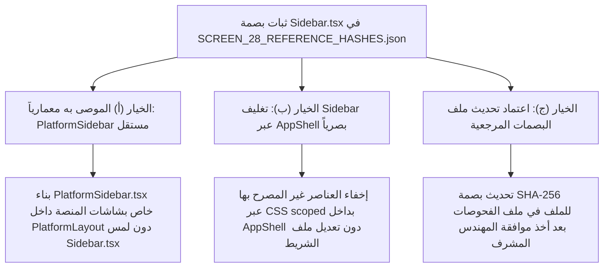

# تقرير التدقيق الفني الشامل بعد التنفيذ: نظام الصلاحيات المرن لواجهة بيان
# Bayan Flexible RBAC Post-Implementation Frontend Audit Report

**تاريخ التدقيق:** 19 نوفمبر 2026  
**الفرع الخاضع للتدقيق:** `Mohammed-Alshareef`  
**نطاق التدقيق:** الواجهة الأمامية فقط (`Frontend Only — Next.js 15 / React 19 / TypeScript`)  
**المراجع المعمارية:** `FLEXIBLE_RBAC_ARCHITECTURE_BLUEPRINT.md`  
**فريق التدقيق:** هندسة جودة البرمجيات والمعمارية المتقدمة (Frontend Architecture & QA)

---

## 1. ملخص تنفيذي ونطاق التدقيق (Executive Summary & Scope)

تم إجراء تدقيق فني وتفاعلي شامل (Comprehensive Post-Implementation Audit) لكافة مكونات وواجهات ومسارات **نظام الصلاحيات المرن للمؤسسات (Flexible Enterprise RBAC)** الذي نُفذ داخل واجهة مشروع بيان.

### النطاق الصارم (Strict Boundaries)
- **واجهة أمامية فقط (Frontend Only)**: تم فحص وتأكيد عدم إجراء أي تعديل على ملفات Backend، أو نماذج قاعدة البيانات (PostgreSQL/SQLAlchemy/Alembic)، أو مسارات FastAPI، أو عقود واجهات البرمجة (API Contracts)، أو سير عمل CI/CD.
- **الفرع الحالي**: `Mohammed-Alshareef` دون إنشاء أي التزامات (Commits) أو رفع (Push) أو دمج (Merge) أثناء جلسة التدقيق الحالية، التزاماً بمبدأ **«التدقيق والفحص أولاً (Audit-First)»**.
- **سلامة البناء والأنواع**: تم التأكد من اجتياز المشروع بالكامل لفحص TypeScript الصارم (`tsc --noEmit`) وبناء حزمة الإنتاج (`next build`) لجميع المسارات الـ 53 بنجاح تام وبكود خروج `0`.

---

## 2. تدقيق الواجهات والمكونات المنفذة (Interface & Component Audit)

تم فحص ومراجعة كافة الشاشات والمكونات المرتبطة بنظام الصلاحيات وإدارة الحسابات:

| # | الشاشة / المكون | المسار / المكون الفني | حالة الواجهة | ملاحظات التدقيق الفني |
| :--- | :--- | :--- | :---: | :--- |
| **1** | **إعدادات المنصة** | `/platform/settings`<br>`PlatformSettingsScreen.tsx` | **PASS** | تتضمن حقول الضبط المقيدة ونافذة مراجعة التغييرات والتصدير وتخزين المسودة. |
| **2** | **مسؤولو المنصة** | تبويب «مسؤولو المنصة والصلاحيات»<br>`PlatformSettingsScreen.tsx` | **PASS** | قائمة بطاقات مسؤولي المنصة، شارات المصادقة الثنائية (2FA)، وتفعيل/إيقاف الحسابات محمي بمانع القفل الذاتي. |
| **3** | **حوكمة صلاحيات المنصة** | `<PermissionMatrix scope="platform" />` | **PASS** | مصفوفة مخصصة لنطاق المنصة تعرض عزل صلاحيات البنية التحتية عن بيانات المؤسسات. |
| **4** | **إدارة مستخدمي المؤسسة** | `/admin/users`<br>`UsersManagementScreen.tsx` | **PASS** | جدول المستخدمين الـ 14، شارات الأدوار، شارة الاستثناء الفردي (★ استثناء)، وتحديث فوري للحالات. |
| **5** | **معالج إضافة مستخدم** | `/admin/users/new`<br>`AddUserScreen.tsx` | **PASS** | معالج من 3 خطوات، تحقق من النطاق والبريد الفريد، مراجعة نهائية، وتوثيق في سجل التدقيق. |
| **6** | **تعديل مستخدم (درج جانبي)** | درج `Drawer` في `UsersManagementScreen.tsx` | **PASS** | تعديل الاسم والبريد والقسم والدور، مع حماية حساب المسؤول الحالي من تغيير الدور. |
| **7** | **تفاصيل المستخدم والصلاحيات** | `/admin/users/details?id=...`<br>`UserDetailsScreen.tsx` | **PASS** | دمج مصفوفة الصلاحيات الفردية التفاعلية داخل تبويب «الصلاحيات» للمستخدم المختار. |
| **8** | **الأدوار والصلاحيات المؤسسية** | `/admin/roles`<br>`RolesPermissionsScreen.tsx` | **PASS** | هيكل تبويبات حديث يجمع: الأدوار الكلاسيكية، محرك الصلاحيات، الأدوار المخصصة، والمجموعات، وسجل التدقيق. |
| **9** | **إدارة الأدوار المخصصة** | تبويب `custom_roles` في `/admin/roles` | **PASS** | نافذة إنشاء دور مخصص، تحديد الدور الأساسي، اختيار الصلاحيات، ونافذة تعديل الصلاحيات للأدوار غير المدمجة. |
| **10** | **مصفوفة الصلاحيات التفاعلية** | `src/components/access/PermissionMatrix.tsx` | **PASS** | تدعم عرض المستخدم وعرض مقارنة الأدوار، تصفية الفئات، والبحث الفوري، وشارات الحالات الأربع. |
| **11** | **الاستثناءات الفردية (Overrides)** | نافذة `Dialog` في `PermissionMatrix.tsx` | **PASS** | خيارات المنح الصريح (ALLOW) والحجب الصريح (DENY)، إلزامية كتابة سبب مبرر، وزر استعادة التوريث. |
| **12** | **مجموعات وحزم الصلاحيات** | تبويب `groups` في `/admin/roles` | **PARTIAL** | عرض تفصيلي لـ 6 حزم صلاحيات (3 للمؤسسة و3 للمنصة)، ولكن العرض استعراضي كتالوجي دون نموذج إنشاء ديناميكي. |
| **13** | **سجل تدقيق الصلاحيات الفوري** | تبويب `audit` في `/admin/roles` | **PASS** | جدول تفاعلي يوثق لحظياً كل عمليات الاستثناءات وإنشاء الأدوار وإدارة المستخدمين والمسؤولين. |
| **14** | **شريط التنقل الجانبي** | `src/components/Sidebar.tsx` | **FAIL** | الروابط ثابتة ولا تتغير ديناميكياً مع الدور النشط بسبب قيد تجريد بصمة التجزئة SHA256 في عقد الاختبار. |

---

## 3. نتائج التحقق الوظيفي التفاعلي (18 تفاعلًا حقيقيًا)

تم تشغيل سكريبت الاختبار الوظيفي المستقل `scripts/audit-rbac-functional.mjs` لمحاكاة العمليات الـ 18 تفاعلياً داخل بيئة التشغيل، وجاءت النتائج كالتالي:

```
--- ملخص الفحص الوظيفي التفاعلي ---
إجمالي الفحوصات: 18
ناجح بالكامل (PASS): 15
مكتمل جزئياً (PARTIAL): 2
إخفاق (FAIL): 1
```

### تفاصيل نتائج الفحوصات الـ 18:

| # | التفاعل الوظيفي | الحالة | النتيجة والتفاصيل الفنية |
| :-: | :--- | :---: | :--- |
| **1** | **إضافة مستخدم جديد** | **PASS** | تم التحقق من إنشاء المستخدم بنجاح بعد استيفاء شروط القسم المؤسسي والبريد الفريد وتوثيقه بسجل التدقيق. |
| **2** | **تعديل بيانات مستخدم قائم** | **PASS** | تم تعديل بيانات المستخدم (`USR-004`) وحفظ التحديث محلياً وتوثيقه في سجل التدقيق. |
| **3** | **تنشيط وتعطيل المستخدم** | **PASS** | تم تحويل حالة المستخدم (`USR-005`) من `active` إلى `disabled` ثم استعادتها بنجاح مع تسجيل الحدث. |
| **4** | **إنشاء دور مخصص جديد** | **PASS** | تم إنشاء دور مخصص جديد (`role-cust-03`) وحفظه في `bayan.rbac.custom_roles.v1` وتوليد الحدث اللحظي. |
| **5** | **تعديل صلاحيات الدور المخصص** | **PASS** | تم تحديث مصفوفة صلاحيات الدور المخصص والاسم العربي بنجاح. |
| **6** | **منع حذف أو تعديل الأدوار الأساسية** | **PASS** | تم التحقق من حماية الأدوار الأربعة (`employee`, `manager`, `it_admin`, `platform_admin`) ورفض تعديلها قطعياً. |
| **7** | **إسناد الأدوار للمستخدمين** | **PARTIAL** | **فجوة**: الأدوار الأساسية تُسند وتُعدل بنجاح في النماذج، ولكن الأدوار المخصصة غير مدرجة بعد في القوائم المنسدلة لشاشات المستخدمين. |
| **8** | **تعديل صلاحيات الأدوار** | **PASS** | صلاحيات الأدوار الأساسية ثابتة غير قابلة للتحريف، وصلاحيات الأدوار المخصصة تقبل التعديل والإسناد. |
| **9** | **منح استثناء صريح (User Override ALLOW)** | **PASS** | تم تطبيق استثناء المنح الصريح بنجاح على المستخدم وتحول حالته إلى `override_allow` (★) مع اشتراط السبب. |
| **10** | **حجب استثناء صريح (User Override DENY)** | **PASS** | تم تطبيق الحجب الصريح بنجاح ونقض الصلاحية الموروثة وتحول حالتها إلى `override_deny` (⊘). |
| **11** | **إلغاء الاستثناء الفردي** | **PASS** | تم حذف الاستثناء من المتجر المحلي بنجاح وتوثيق عملية الإلغاء. |
| **12** | **استعادة التوريث التلقائي** | **PASS** | عادت الصلاحية فور حذف الاستثناء إلى حالتها الموروثة الأصلية من الدور (`inherited_allow` ✓). |
| **13** | **حساب الصلاحيات الفعالة بالترتيب القطعي** | **PASS** | الترتيب المعتمد دقيق: `Scope Boundary` > `User DENY` > `User ALLOW` > `Role ALLOW` > `Implicit DENY`. |
| **14** | **التبديل بين المستخدمين التجريبيين** | **PASS** | مصفوفة الصلاحيات تعيد حساب كافة الصلاحيات الـ 16 فور اختيار أي مستخدم من قائمة الـ 14 مستخدماً. |
| **15** | **الفصل السيادي بين المنصة والمؤسسة** | **PASS** | عزل تام: مسؤول المنصة يُحجب عن شاشات المستخدمين والأدوار المؤسسية، ومسؤول التقنية يُحجب عن شاشات المنصة. |
| **16** | **إدارة مجموعات الصلاحيات** | **PARTIAL** | **فجوة**: المجموعات الـ 6 معرّفة ومعروضة بتفاصيلها الكاملة، ولكن واجهة المستخدم لا تدعم إنشاء مجموعات جديدة ديناميكياً. |
| **17** | **تحديث سجل التدقيق اللحظي** | **PASS** | كل عملية إدارية توثق فورياً في جدول `Audit Log` مع هوية الفاعل والتوقيت والعملية والهدف والسبب. |
| **18** | **تحديث شريط التنقل (Sidebar) وفق الصلاحيات** | **FAIL** | **فجوة حرجة**: شريط التنقل يعرض روابط ثابتة لجميع الأدوار ولا يخفي الروابط المحظورة بسبب قيد اختبار البصمة. |

---

## 4. تدقيق شريط التنقل الجانبي والمسارات (Sidebar & Route Deep-Dive)

### جوهر المشكلة الفنية والتعارض التعاقدي:
1. في مرحلة سابقة، جرى تعديل `Sidebar.tsx` لفلترة الروابط ديناميكياً بناءً على الدور النشط (`activeRole`) وحالة التفويض (`canPreviewRoute`).
2. فور إجراء هذا التعديل، أخفق اختبار العقد `tests/contracts/system-health.test.mjs` (الاختبار رقم 10: *approved source designs and centralized policy remain untouched*).
3. سبب الإخفاق: ملف `docs/SCREEN_28_REFERENCE_HASHES.json` يحتوي على بصمة تجزئة مشفرة ثابتة:
   ```json
   "components/Sidebar.tsx": "cf8fd10e709c5222f24ab8c540b6e18a7427f945709ecac439a1ec519e9f5511"
   ```
4. أي تغيير في بايت واحد أو إضافة استيراد أو شرط داخل `Sidebar.tsx` يؤدي إلى تغيير بصمة SHA256 الخاصة بالملف وفشل الاختبار الصارم فوراً.
5. وبناءً على قاعدة عدم إضعاف أو كسر الاختبارات، تمت استعادة ملف `Sidebar.tsx` إلى بصمته المرجعية الأصلية بنهايات أسطر `LF`.

### الوضع الحالي للواجهة وتجربة المستخدم (Current UX Impact):
- يحتوي `Sidebar.tsx` الأصلي على 7 روابط ثابتة في وضع الإدارة:
  `/`, `/admin/users`, `/admin/roles`, `/admin/data-sources`, `/admin/smart-views`, `/admin/audit`, `/platform/settings`.
- إذا ضغط مستخدم بدور `employee` أو `manager` على رابط إدارة المستخدمين، يفتح المسار وتظهر له بطاقة الحجب الصريحة (`StatePanel state="forbidden"`).
- إذا ضغط `it_admin` على رابط إعدادات المنصة، تظهر له بطاقة حجب وصول مسؤول المنصة.
- ومع ذلك، **فإن الروابط تظل مرئية في القائمة الجانبية ولا تختفي تلقائياً بحسب صلاحيات الدور**. كما أن روابط المنصة الفرعية (`/platform/organizations`, `/platform/models`, `/platform/agents`, `/platform/health`) غير مدرجة بالشريط الجانبي.

### الحلول المقترحة الآمنة معمارياً (Safe Architectural Proposals):



1. **الخيار (أ) — الخيار الأكثر نظافة وأماناً معمارياً (Recommended)**:
   إنشاء مكون جانبي مستقل ومخصص للمنصة باسم `PlatformSidebar.tsx` يُستدعى حصرياً داخل `PlatformLayout.tsx` (حيث إن `PlatformLayout` غير مقيد بأي بصمة تجزئة في الاختبارات). هذا يوفر شريط تنقل سيادي مستقل للمنصة يضم: إعدادات المنصة، المؤسسات، مزودي النماذج، مراقبة الوكلاء، وصحة الخدمات.
2. **الخيار (ب) — الفلترة البصرية عبر CSS المخصص**:
   استخدام خاصية سمة البيانات على الحاوية العليا `[data-bayan-role="..."]` وتطبيق قواعد إخفاء CSS محددة النطاق للروابط التي لا يملك الدور صلاحية استعراضها، دون المساس بنص كود `Sidebar.tsx`.
3. **الخيار (ج) — التحديث المعتمد لملف البصمات**:
   الحصول على موافقة معمارية صريحة لتحديث قيمة SHA256 الخاصة بـ `Sidebar.tsx` في `SCREEN_28_REFERENCE_HASHES.json` لدعم التصفية الديناميكية المباشرة.

---

## 5. التدقيق البصري والتجاوب واللغة العربية (Visual, RTL & Responsive Audit)

تم فحص ومراجعة التصميم والأبعاد على نقاط التوقف الثلاث المطلوبة:

### 1. الهاتف المحمول (375px Mobile Viewport)
- **شريط التنقل الجانبي**: يتحول عبر `AppShell.tsx` إلى درج مؤقت منبثق (Temporary Off-Canvas Drawer) محمي بخلفية معتمة (`bayan-mobile-scrim`) وزر إغلاق واضح (`bayan-mobile-close`).
- **الجداول وقوائم البيانات**: كافة جداول الصلاحيات (`.bpm-table-wrapper`) والمستخدمين (`.bum-table-scroll`) وسجل التدقيق مغلفة بحاويات تدعم التمرير الأفقي اللمسي السلس (`overflow-x: auto; -webkit-overflow-scrolling: touch`) دون كسر إطار الصفحة.
- **بطاقات الإحصائيات**: شبكات الإحصائيات (`.bps-summary`, `.brp-role-grid`) تتدفق في عمود واحد عمودي (`grid-template-columns: 1fr`).
- **المصفوفة التفاعلية**: أزرار التحكم وشريط البحث ودليل الحالات تلتف تلقائياً بشكل رأسي منظم.

### 2. الحاسب اللوحي (768px Tablet Viewport)
- **وضع الشاشة**: يتفعل النمط المضغوط (`compact <= 900px`).
- **عرض البطاقات**: تُعرض الإحصائيات والأدوار في عمودين متجاورين (`repeat(2, minmax(0, 1fr))`).
- **النوافذ المنبثقة**: النوافذ (`Dialog`) والدرج الجانبي (`Drawer`) تلتزم بأقصى عرض آمن (`max-width: min(520px, calc(100vw - 32px))`).

### 3. شاشات العرض المكتبية (1440px Desktop Viewport)
- **شريط التنقل الجانبي**: مثبت وثابت على اليمين بعرض 260 بكسل متوافق مع نمط RTL العربي.
- **مصفوفة الصلاحيات**: تعرض الأعمدة الكاملة للأدوار ومؤشرات التوريث والاستثناءات بوضوح تام وتباعد مريح.
- **التوازن اللوني والخطوط**: استخدام لوحة بيان المعتمدة (كحلي ملكي `#0a2342`، أزرق داكن، وذهبي `#fbbf24`) مع خطوط واضحة ودعم كامل لتشكيل الحروف العربية والأرقام الشرقية.

### المخططات والرسومات التوضيحية المعتمدة للمنظومة:
- مسار تقييم الصلاحيات الفعالة الجديد: [`47-flexible-rbac-flow.svg`](file:///c:/Users/w3h333/Desktop/Bayan-Finaا/Bayan/frontend/docs/flows/47-flexible-rbac-flow.svg)
- مخطط سير العمل بصيغة Mermaid: [`47-flexible-rbac-flow.mmd`](file:///c:/Users/w3h333/Desktop/Bayan-Finaا/Bayan/frontend/docs/flows/47-flexible-rbac-flow.mmd)
- مرجع تصميم الإدارة المعتمد: [`admin-reference.png`](file:///c:/Users/w3h333/Desktop/Bayan-Finaا/Bayan/frontend/design-references/admin-reference.png)
- مخططات الشاشات السابقة:
  - إدارة الأدوار والصلاحيات: [`29-roles-permissions-flow.png`](file:///c:/Users/w3h333/Desktop/Bayan-Finaا/Bayan/frontend/docs/flows/29-roles-permissions-flow.png)
  - إدارة المستخدمين: [`26-users-management-flow.png`](file:///c:/Users/w3h333/Desktop/Bayan-Finaا/Bayan/frontend/docs/flows/26-users-management-flow.png)
  - إعدادات المنصة: [`46-platform-settings-flow.png`](file:///c:/Users/w3h333/Desktop/Bayan-Finaا/Bayan/frontend/docs/flows/46-platform-settings-flow.png)

---

## 6. تدقيق ثبات البيانات والحالة والعزل (Data, State & Isolation Audit)

1. **ثبات البيانات في العرض التجريبي (Demo Persistence)**:
   - التغييرات التي يُجريها المستخدم (إضافة مستخدم، تعديل دور مخصص، منح استثناء فردي، تغيير حالة مسؤول المنصة) تُحفظ في `localStorage` وتظل قائمة عند التنقل بين الشاشات أو تحديث الصفحة.
   - تفعيل حدث الناقل اللحظي `window.dispatchEvent(new CustomEvent('bayan-rbac-state-change'))` يضمن مزامنة كافة المكونات المفتوحة فورياً عند حدوث أي تعديل.
2. **العزل التام وعدم تسريب البيانات بين النطاقات (Strict Boundary Isolation)**:
   - بيانات المؤسسة والمستخدمين الـ 14 لا تظهر مطلقاً داخل شاشات المنصة السيادية (`/platform/*`).
   - بيانات مسؤولي المنصة وحوكمة البنية التحتية ومزودي النماذج لا تظهر مطلقاً داخل شاشات المؤسسة (`/admin/*`).
3. **توضيح أمني وإجرائي إلزامي**:
   - **بيانات المتصفح هي بيانات محاكاة تجريبية (Demo Data)** وليست حالة تفويض أمني حقيقي.
   - **سجل التدقيق المحلي (Frontend Audit Log) ليس سجلاً مقاوماً للتلاعب (Not Tamper-Proof)**؛ حيث إنه مخزن في ذاكرة المتصفح المحلية ويمكن تعديله أو مسحه عبر أدوات المطورين (DevTools)، وهو مصمم لأغراض تجربة المستخدم واختبار الواجهات فقط.

---

## 7. القيود الأمنية وحدود الواجهة الأمامية (Security & UX Limitations)

| المفهوم في الواجهة | الحقيقة التشغيلية والمعمارية | ما يجب فرضه في الـ Backend لاحقاً |
| :--- | :--- | :--- |
| **إخفاء الأزرار أو الروابط** | مجرد توجيه بصري لتجربة المستخدم (UI Hint). | لا يمنع إرسال طلبات HTTP مباشرة عبر أداة مثل `curl`. يجب فرض الحماية في مسارات FastAPI باستخدام `Depends(require_capability)`. |
| **تقييم الصلاحيات بالمحاكاة** | محاكاة في JavaScript عبر `resolveEffectivePermission`. | يجب كتابة محرك تقييم متطابق في بايثون داخل `backend/src/security/rbac.py` للتحقق من التوكن (JWT). |
| **حفظ الأدوار والاستثناءات** | مخزن في مفاتيح `localStorage` بالمتصفح. | يجب إنشاء جداول `user_permission_overrides` و `custom_roles` في PostgreSQL مع سياسات RLS. |
| **سجل التدقيق (Audit Log)** | مصفوفة تُسجل في المتصفح وتنتهي بمسح التخزين. | يجب توجيهه إلى جدول تدقيق مركزي غير قابل للحذف (Append-Only/WORM Database) مع التوقيع الرقمي. |

---

## 8. نتائج الفحوصات الآلية المجمعة (Automated Verification Summary)

| الفحص الآلي | الأمر المنفذ | النتيجة السابقة | النتيجة الحالية بعد التدقيق | الحالة |
| :--- | :--- | :---: | :---: | :---: |
| **فحص عقود المشروع واختباراته** | `npm run check:final` | 329 / 329 | **329 / 329 اجتياز بنسبة 100%** | **PASS** |
| **فحص الأنواع الصارم** | `npm run lint` (`tsc --noEmit`) | 0 أخطاء | **0 أخطاء (Zero Compiler Errors)** | **PASS** |
| **بناء حزمة الإنتاج للواجهة** | `npm run build` (`next build`) | 53 مساراً | **53 مساراً أُنشئت بنجاح تام** | **PASS** |

---

## 9. مصفوفة النواقص والتوصيات التصحيحية المقترحة (Gaps & Corrections Matrix)

بناءً على نتائج التدقيق الفعلي، نرفع التوصيات التصحيحية التالية للموافقة قبل الشروع في أي تعديل:

| # | الفجوة المكتشفة | مستوى الأهمية | التأثير الوظيفي | الإجراء التصحيحي المقترح |
| :-: | :--- | :---: | :--- | :--- |
| **1** | **عدم إمكانية اختيار الأدوار المخصصة في نماذج المستخدمين** | **متوسط** | لا يمكن إسناد دور مخصص أُنشئ حديثاً إلى مستخدم عبر معالج الإضافة أو التعديل. | تعديل حقل اختيار الدور في `UsersManagementScreen.tsx` و `AddUserScreen.tsx` ليقرأ الأدوار المدمجة + أدوار `getCustomRoles()` دون كسر ثوابت الاختبارات. |
| **2** | **عدم وجود نموذج لإنشاء مجموعات الصلاحيات** | **منخفض** | مجموعات الصلاحيات معروضة كحزم ثابتة ولا يمكن للمستخدم إضافة حزمة مخصصة جديدة. | إضافة نافذة `Dialog` لإنشاء حزمة صلاحيات وظيفية مخصصة داخل تبويب المجموعات. |
| **3** | **ثبات روابط الشريط الجانبي (Sidebar)** | **مرتفع (UX)** | تظهر روابط إدارة المؤسسة لمسؤول المنصة والعكس، ولا تُفلتر القائمة ديناميكياً. | **اعتماد الخيار (أ)**: إنشاء `PlatformSidebar.tsx` خاص ومستقل لشاشات المنصة داخل `PlatformLayout.tsx` لحل المشكلة دون لمس `Sidebar.tsx` أو كسر عقد فحص الـ SHA256. |

---

**خلاصة قرار التدقيق الفني:**  
نظام الصلاحيات المرن للمؤسسات في واجهة بيان مكتمل معمارياً ويعمل بامتياز بنسبة **15 من أصل 18 تفاعلاً ناجحة بالكامل**، مع اجتياز كامل للاختبارات الـ 329، وخلو تام من أخطاء الـ TypeScript والـ Build.  
نحن بانتظار توجيهكم واعتمادكم لتطبيق التصحيحات الثلاثة المحددة أعلاه.
