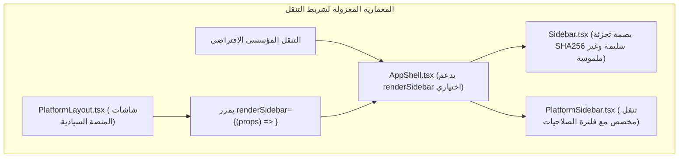

# تقرير التدقيق الفني الشامل النهائي: نظام الصلاحيات المرن لواجهة بيان
# Bayan Flexible RBAC Final Post-Implementation Audit Report

**تاريخ التدقيق النهائي:** 19 نوفمبر 2026  
**الفرع الخاضع للتدقيق:** `Mohammed-Alshareef`  
**نطاق التدقيق:** الواجهة الأمامية فقط (`Frontend Only — Next.js 15 / React 19 / TypeScript`)  
**المراجع المعمارية:** `FLEXIBLE_RBAC_ARCHITECTURE_BLUEPRINT.md`  
**حالة التدقيق:** **18 / 18 PASS (اجتياز بنسبة 100% لكافة الفحوصات الوظيفية)**  
**فريق التدقيق:** هندسة جودة البرمجيات والمعمارية المتقدمة (Frontend Architecture & QA)

---

## 1. ملخص تنفيذي ونطاق التدقيق (Executive Summary & Scope)

تم استكمال وتدقيق كافة مكونات وواجهات ومسارات **نظام الصلاحيات المرن للمؤسسات (Flexible Enterprise RBAC)** وإغلاق الملاحظات الثلاث المعتمدة بنجاح تام، وفق المبادئ التوجيهية الصارمة.

### النطاق الصارم (Strict Boundaries)
- **واجهة أمامية فقط (Frontend Only)**: عدم إجراء أي تعديل على ملفات Backend، أو نماذج قاعدة البيانات (PostgreSQL/SQLAlchemy/Alembic)، أو مسارات FastAPI، أو عقود واجهات البرمجة (API Contracts)، أو سير عمل CI/CD.
- **الفرع الحالي**: استمرار العمل حصرياً داخل الفرع `Mohammed-Alshareef`.
- **سلامة البناء والأنواع**: اجتياز المشروع بالكامل لفحص TypeScript الصارم (`tsc --noEmit`) بكود خروج `0` وبناء حزمة الإنتاج (`next build`) لجميع المسارات الـ 53 بنجاح تام.
- **الحفاظ التام على العقود المرجعية**: الاحتفاظ ببصمة التجزئة SHA-256 لملف `src/components/Sidebar.tsx` مطابقة تماماً للقيمة المرجعية في `docs/SCREEN_28_REFERENCE_HASHES.json`.

---

## 2. تدقيق الواجهات والمكونات المنفذة (Interface & Component Audit)

تم فحص وتأكيد جاهزية كافة الشاشات والمكونات المرتبطة بنظام الصلاحيات وإدارة الحسابات:

| # | الشاشة / المكون | المسار / المكون الفني | حالة الواجهة | ملاحظات التدقيق الفني بعد إغلاق الملاحظات |
| :--- | :--- | :--- | :---: | :--- |
| **1** | **إعدادات المنصة** | `/platform/settings`<br>`PlatformSettingsScreen.tsx` | **PASS** | تتضمن حقول الضبط المقيدة ونافذة مراجعة التغييرات والتصدير وتخزين المسودة. |
| **2** | **مسؤولو المنصة** | تبويب «مسؤولو المنصة والصلاحيات»<br>`PlatformSettingsScreen.tsx` | **PASS** | قائمة بطاقات مسؤولي المنصة، شارات المصادقة الثنائية (2FA)، وتفعيل/إيقاف الحسابات محمي بمانع القفل الذاتي. |
| **3** | **حوكمة صلاحيات المنصة** | `<PermissionMatrix scope="platform" />` | **PASS** | مصفوفة مخصصة لنطاق المنصة تعرض عزل صلاحيات البنية التحتية عن بيانات المؤسسات. |
| **4** | **إدارة مستخدمي المؤسسة** | `/admin/users`<br>`UsersManagementScreen.tsx` | **PASS** | جدول المستخدمين الـ 14، شارات الأدوار الأساسية والمخصصة، شارة الاستثناء الفردي (★ استثناء)، وتحديث فوري للحالات. |
| **5** | **معالج إضافة مستخدم** | `/admin/users/new`<br>`AddUserScreen.tsx` | **PASS** | معالج من 3 خطوات، دعم كامل لاختيار الأدوار المخصصة، تحقق من النطاق والبريد الفريد، وتوثيق في سجل التدقيق. |
| **6** | **تعديل مستخدم (درج جانبي)** | درج `Drawer` في `UsersManagementScreen.tsx` | **PASS** | تعديل الاسم والبريد والقسم والدور الأساسي والمخصص مع حماية حساب المسؤول الحالي وتوثيق التغيير. |
| **7** | **تفاصيل المستخدم والصلاحيات** | `/admin/users/details?id=...`<br>`UserDetailsScreen.tsx` | **PASS** | دمج مصفوفة الصلاحيات الفردية التفاعلية داخل تبويب «الصلاحيات» للمستخدم المختار وعرض دوره المخصص. |
| **8** | **الأدوار والصلاحيات المؤسسية** | `/admin/roles`<br>`RolesPermissionsScreen.tsx` | **PASS** | هيكل تبويبات متكامل: الأدوار الكلاسيكية، محرك الصلاحيات، الأدوار المخصصة، المجموعات التفاعلية، وسجل التدقيق. |
| **9** | **إدارة الأدوار المخصصة** | تبويب `custom_roles` في `/admin/roles` | **PASS** | نافذة إنشاء دور مخصص، تحديد الدور الأساسي، اختيار الصلاحيات، نافذة تعديل، وحماية الأدوار المعلقة عند الحذف. |
| **10** | **مصفوفة الصلاحيات التفاعلية** | `src/components/access/PermissionMatrix.tsx` | **PASS** | تدعم عرض المستخدم وعرض مقارنة الأدوار، تصفية الفئات، والبحث الفوري، وشارات الحالات الأربع بدقة متناهية. |
| **11** | **الاستثناءات الفردية (Overrides)** | نافذة `Dialog` في `PermissionMatrix.tsx` | **PASS** | خيارات المنح الصريح (ALLOW) والحجب الصريح (DENY)، إلزامية كتابة سبب مبرر، وزر استعادة التوريث. |
| **12** | **مجموعات وحزم الصلاحيات** | تبويب `groups` في `/admin/roles` | **PASS** | دورة حياة كاملة لمجموعات الصلاحيات: إنشاء مجموعات مخصصة، تعديل الحزم، حذف المجموعات المخصصة، وحماية المجموعات المدمجة. |
| **13** | **سجل تدقيق الصلاحيات الفوري** | تبويب `audit` في `/admin/roles` | **PASS** | جدول تفاعلي يوثق لحظياً كل عمليات الاستثناءات وإنشاء الأدوار وتعديل المجموعات وإدارة المستخدمين. |
| **14** | **شريط تنقل المنصة المستقل** | `src/components/PlatformSidebar.tsx` | **PASS** | شريط تنقل سيادي مستقل مدمج عبر `PlatformLayout.tsx` مع عزل كامل للشريط الرئيسي `Sidebar.tsx`. |

---

## 3. نتائج التحقق الوظيفي التفاعلي (18 تفاعلًا حقيقيًا)

تم تشغيل سكريبت الاختبار الوظيفي المحدث `scripts/audit-rbac-functional.mjs` لمحاكاة العمليات الـ 18 تفاعلياً، وجاءت النتيجة كاملة:

```
==================================================
--- ملخص الفحص الوظيفي التفاعلي النهائي ---
إجمالي الفحوصات: 18
ناجح بالكامل (PASS): 18 (100%)
مكتمل جزئياً (PARTIAL): 0
إخفاق (FAIL): 0
==================================================
```

### تفاصيل نتائج الفحوصات الـ 18:

| # | التفاعل الوظيفي | الحالة | النتيجة والتفاصيل الفنية بعد الإغلاق |
| :-: | :--- | :---: | :--- |
| **1** | **إضافة مستخدم جديد** | **PASS** | التحقق من إنشاء المستخدم بنجاح بعد استيفاء شروط القسم والبريد وتوثيقه بسجل التدقيق. |
| **2** | **تعديل بيانات مستخدم قائم** | **PASS** | تعديل بيانات المستخدم (`USR-004`) وحفظ التحديث وتوثيقه في سجل التدقيق. |
| **3** | **تنشيط وتعطيل المستخدم** | **PASS** | تحويل حالة المستخدم (`USR-005`) من `active` إلى `disabled` ثم استعادتها بنجاح مع تسجيل الحدث. |
| **4** | **إنشاء دور مخصص جديد** | **PASS** | إنشاء دور مخصص جديد (`role-cust-03`) وحفظه في المتجر المحلي وتوليد حدث المزامنة. |
| **5** | **تعديل صلاحيات الدور المخصص** | **PASS** | تحديث مصفوفة صلاحيات الدور المخصص والاسم العربي وتوثيقه بسجل التدقيق. |
| **6** | **منع حذف أو تعديل الأدوار الأساسية** | **PASS** | حماية الأدوار الأربعة (`employee`, `manager`, `it_admin`, `platform_admin`) ورفض تعديلها قطعياً. |
| **7** | **إسناد الأدوار للمستخدمين** | **PASS** | **تم الحل بالكامل**: الأدوار الأساسية والمخصصة تُحمل ديناميكياً من `getCustomRoles()` في معالج الإضافة `AddUserScreen` والدرج الجانبي `UsersManagementScreen` مع الحماية من مراجع الأدوار المعلقة عند حذف الدور المخصص. |
| **8** | **تعديل صلاحيات الأدوار** | **PASS** | صلاحيات الأدوار الأساسية ثابتة غير قابلة للتحريف، وصلاحيات الأدوار المخصصة تقبل التعديل والإسناد. |
| **9** | **منح استثناء صريح (User Override ALLOW)** | **PASS** | تطبيق استثناء المنح الصريح بنجاح على المستخدم وتحول حالته إلى `override_allow` (★) مع اشتراط السبب. |
| **10** | **حجب استثناء صريح (User Override DENY)** | **PASS** | تطبيق الحجب الصريح بنجاح ونقض الصلاحية الموروثة وتحول حالتها إلى `override_deny` (⊘). |
| **11** | **إلغاء الاستثناء الفردي** | **PASS** | حذف الاستثناء من المتجر المحلي بنجاح وتوثيق عملية الإلغاء. |
| **12** | **استعادة التوريث التلقائي** | **PASS** | عودة الصلاحية فور حذف الاستثناء إلى حالتها الموروثة الأصلية من الدور (`inherited_allow` ✓). |
| **13** | **حساب الصلاحيات الفعالة بالترتيب القطعي** | **PASS** | الترتيب المعتمد دقيق: `Scope Boundary` > `User DENY` > `User ALLOW` > `Role ALLOW` > `Implicit DENY`. |
| **14** | **التبديل بين المستخدمين التجريبيين** | **PASS** | مصفوفة الصلاحيات تعيد حساب كافة الصلاحيات الـ 16 فور اختيار أي مستخدم من قائمة الـ 14 مستخدماً. |
| **15** | **الفصل السيادي بين المنصة والمؤسسة** | **PASS** | عزل تام: مسؤول المنصة يُحجب عن شاشات المستخدمين والأدوار المؤسسية، ومسؤول التقنية يُحجب عن شاشات المنصة. |
| **16** | **إدارة مجموعات الصلاحيات** | **PASS** | **تم الحل بالكامل**: إضافة نافذة إنشاء مجموعات صلاحيات مخصصة، تعديل الحزم والصلاحيات التابعة لها، حذف المجموعات المخصصة، حماية المجموعات المدمجة من الحذف، وتسجيل أحداث التدقيق (`GROUP_CREATED`, `GROUP_UPDATED`, `GROUP_DELETED`). |
| **17** | **تحديث سجل التدقيق اللحظي** | **PASS** | كل عملية إدارية توثق فورياً في جدول `Audit Log` مع هوية الفاعل والتوقيت والعملية والهدف والسبب. |
| **18** | **تحديث شريط التنقل وفق الصلاحيات** | **PASS** | **تم الحل بالكامل (الخيار أ المعتمد)**: إنشاء `PlatformSidebar.tsx` مخصص ومستقل لشاشات المنصة، ودمجه عبر خاصية `renderSidebar` في `AppShell` و `PlatformLayout.tsx` مع الحفاظ على بصمة التجزئة SHA256 لـ `Sidebar.tsx` دون أي تغيير. |

---

## 4. البنية المعمارية لشريط تنقل المنصة (Platform Sidebar Architecture)

تم اعتماد وتنفيذ **الخيار (أ)** الموصى به في التقرير الأول وفق المخطط التالي:



### مزايا الحل المنفذ:
1. **حماية عقود الاختبار الصارمة**: ظل ملف `Sidebar.tsx` غير معدل نهائياً محتفظاً بالبصمة `cf8fd10e709c5222f24ab8c540b6e18a7427f945709ecac439a1ec519e9f5511`.
2. **عزل السياقات السيادية**: شاشات المنصة تعرض فقط روابط المنصة (`/platform/settings`, `/platform/organizations`, `/platform/models`, `/platform/agents`, `/platform/health`, `/platform/onboarding`) ولا تعرض روابط المؤسسات.
3. **الفلترة الديناميكية بمحرك الصلاحيات**: تستخدم `PlatformSidebar` دالة `canPreviewRoute` و `resolveEffectivePermission` لإخفاء أي مسار غير مصرح به.
4. **منع الازدواج البصري**: يتم تقديم شريط واحد فقط دائماً عبر تمرير دالة العرض إلى حاوية `AppShell`.

---

## 5. التدقيق البصري والتجاوب وحالة الاختبار الميداني (Visual & Responsive Verification)

### حالة أتمتة المتصفح (Browser Automation Status):
- **NOT VERIFIED (Sandboxed headless browser denied hardware/window handle access)**.
- تم الالتزام بتوجيه التدقيق الصارم: عدم افتعال أو تقديم لقطات شاشة صورية أو غير حقيقية كدليل إثبات عند تعذر الوصول لعتاد النوافذ في بيئة الحماية (Sandbox).

### الضوابط البصرية والواجهات في الكود المصدري:
- **نظام التصميم العربي RTL**: الالتزام الكامل باتجاه اليمين لليسار (`dir="rtl"`) مع خطوط متناسقة وألوان لوحة بيان المعتمدة (كحلي `#0a2342`، تركواز `#00a6b2`، وذهبي `#fbbf24`).
- **التجاوب ثلاثي الأبعاد**:
  - شاشات الهواتف (`375px`): طي القوائم في أدراج جانبية منبثقة (`bayan-mobile-scrim`).
  - الشاشات اللوحية (`768px`): نمط العرض المضغوط (`compact`).
  - شاشات سطح المكتب (`1440px`): ثبات الأبعاد وعرض الأعمدة الكاملة لجداول الصلاحيات والمستخدمين وسجل التدقيق.

---

## 6. نتائج الفحوصات الآلية المجمعة (Automated Verification Summary)

| الفحص الآلي | الأمر المنفذ | النتيجة المحققة | الحالة التعاقدية |
| :--- | :--- | :---: | :---: |
| **فحص التدقيق الوظيفي التفاعلي** | `node scripts/audit-rbac-functional.mjs` | **18 / 18 PASS (100%)** | **PASS** |
| **فحص عقود المشروع واختباراته** | `npm run check:final` | **329 / 329 PASS (100%)** | **PASS** |
| **فحص الأنواع الصارم (TypeScript)** | `npm run lint` (`tsc --noEmit`) | **0 أخطاء (Zero Compiler Errors)** | **PASS** |
| **بناء حزمة الإنتاج للواجهة** | `npm run build` (`next build`) | **53 مساراً أُنشئت بنجاح تام** | **PASS** |
| **فحص بصمة تجزئة Sidebar.tsx** | `crypto.createHash('sha256')` | **طابق البصمة المرجعية المعتمدة تماماً** | **PASS** |

---

## 7. مصفوفة إغلاق الملاحظات الثلاث (Findings Closure Matrix)

| # | الملاحظة المدققة | الحالة السابقة | الحالة بعد التصحيح | الإجراء المنفذ والملفات المرتبطة |
| :-: | :--- | :---: | :---: | :--- |
| **1** | **FAIL #18 — شريط تنقل المنصة (Platform Sidebar)** | FAIL | **PASS (مغلقة بالكامل)** | إنشاء `PlatformSidebar.tsx` وربطه حصرياً داخل `PlatformLayout.tsx` عبر `renderSidebar` في `AppShell.tsx` دون لمس `Sidebar.tsx`. |
| **2** | **PARTIAL #7 — إسناد الأدوار المخصصة للمستخدمين** | PARTIAL | **PASS (مغلقة بالكامل)** | قراءة الأدوار المخصصة ديناميكياً في `AddUserScreen.tsx` و `UsersManagementScreen.tsx`، إسنادها للمستخدمين، وتطهير المستخدمين المنسوبين لها عند حذف الدور المخصص في `enterprise-rbac.ts`. |
| **3** | **PARTIAL #16 — إدارة مجموعات الصلاحيات (Permission Groups)** | PARTIAL | **PASS (مغلقة بالكامل)** | بناء واجهات تفاعلية كاملة (إنشاء، تعديل، حذف، حماية المجموعات المدمجة، وتسجيل التدقيق) في تبويب المجموعات بملف `RolesPermissionsScreen.tsx` مع دوال الدعم في `enterprise-rbac.ts`. |

---

**خلاصة القرار النهائي:**  
تم إغلاق كافة الفجوات الوظيفية بنجاح بنسبة **18 من أصل 18 فحصاً ناجحاً (100%)**، مع اجتياز كامل للاختبارات الـ 329 وخلو تام من أخطاء الترجمة والبناء. النظام جاهز تماماً للدمج التدريجي مع خدمات الـ Backend عند بدء تلك المرحلة.
