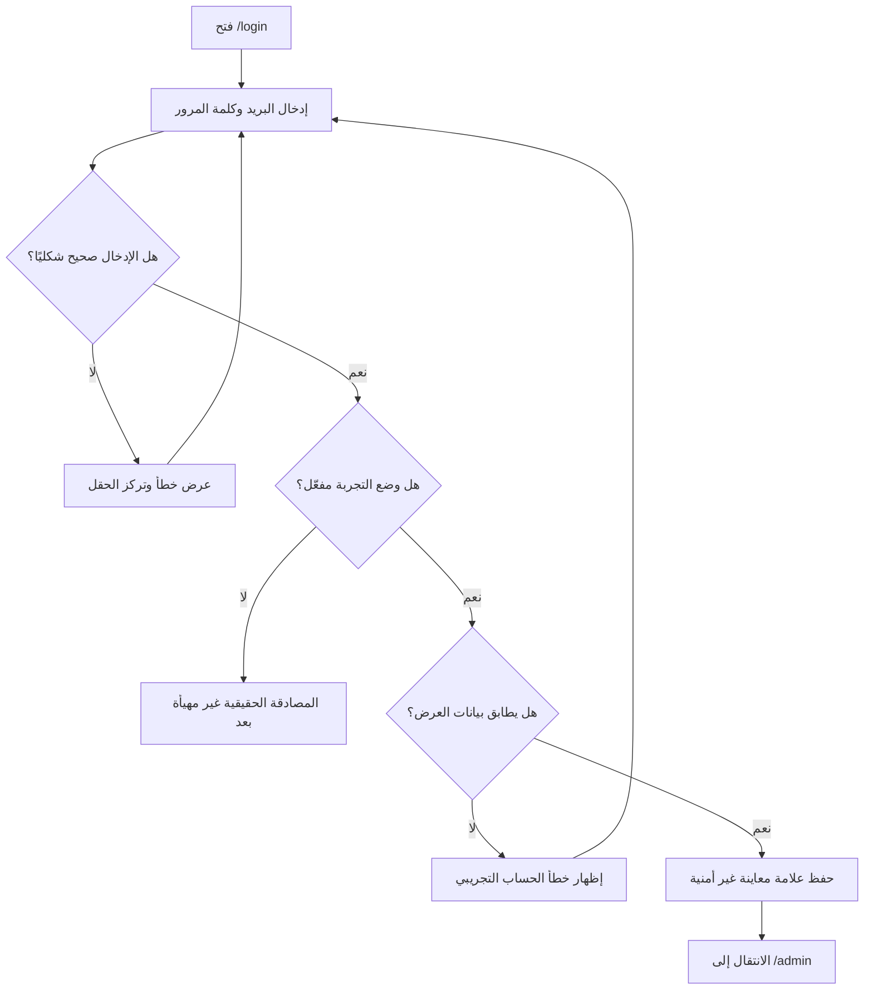

# بيان — الواجهة 01: تسجيل الدخول (`/login`)

**التصنيف:** شاشة فعلية مستقلة ضمن المجموعة «الحساب» من كتالوج 42 شاشة.
**المتطلب المرجعي:** FR-01 وفق كتالوج المشروع؛ المظهر مستمد من هوية Design System المعتمدة `#0A2342` و`#00A6B2`.
**الحالة:** Frontend تجريبي، صالح للتصفح وفحص الإدخال، **غير متصل** بمصادقة Backend، ولا يمثل تحكمًا أمنيًا حقيقيًا.

## ما تم تسليمه

- `app/login/page.tsx`: مسار Next.js مخصص، لا يعتمد على قالب الصفحات العام.
- `components/auth/LoginScreen.tsx`: تخطيط الصفحة ومكون نموذج الدخول.
- `components/auth/login.css`: تنسيق scoped واتجاه RTL والتجاوب لـ Desktop وTablet وMobile.
- `lib/auth/login.ts`: قواعد التحقق المحلية ومعلومات الدخول الخاصة بالمعاينة فقط.
- `tests/e2e/login.spec.ts`: سيناريوهات Playwright معدّة للتشغيل عند توفر الحزم.
- `scripts/verify-login.mjs`: اختبارات بنيوية تعمل دون تنزيل npm.

## قائمة حالات التفاعل

| السيناريو | السلوك الحالي |
|---|---|
| ترك البريد فارغًا | رسالة خطأ بجانب الحقل + تركيز عليه |
| إدخال بريد غير صحيح | رسالة تحقّق بالبريد |
| ترك كلمة المرور فارغة | رسالة خطأ بجانب كلمة المرور |
| إدخال كلمة مرور قصيرة | رسالة لا تقل عن 8 أحرف في المعاينة |
| إظهار / إخفاء كلمة المرور | تغيير نوع الحقل مع تسمية واضحة للقارئ الآلي |
| تذكّر البريد | حفظ البريد فقط في `localStorage` (لا تُحفظ كلمة المرور أبدًا) |
| إدخال حساب تجريبي خاطئ | رسالة خطأ؛ لا يُسمح بتسجيل دخول تجريبي |
| تعبئة حساب تجريبي صحيح | إنشاء حالة معاينة محلية `sessionStorage` ثم الانتقال إلى `/admin` |
| تعطيل المعاينة في الإنتاج | تظهر رسالة أن المصادقة الحقيقية غير مربوطة |
| استعادة كلمة المرور | رابط إلى `/forgot-password`؛ الصفحة الآن مستقلة في الشاشة 02؛ وهي معاينة للطلب لا ترسل بريدًا فعليًا |

### كيفية تجربة الصفحة

بعد تثبيت الحزم:

```bash
npm install
npm run dev
```

افتح `http://localhost:3000/login`، واضغط **تعبئة بيانات التجربة** ثم **تسجيل الدخول**.

يمكن تشغيل اختبارات الواجهة:

```bash
npm run check:login
npm run lint
npm run build
npx playwright install chromium
npm run test:e2e
```

## تدفق تسجيل الدخول التجريبي



## شروط الربط الحقيقي لاحقًا (مقترحات وليست عقود Backend موثقة)

1. اتفاق الفريق مع FastAPI على مسار المصادقة وحقول الطلب والاستجابة، بدل افتراض أن مسارًا معينًا موجود.
2. اعتماد جلسة يوقّعها الخادم، والأفضل تخزين معرف الجلسة في Cookie `HttpOnly`, `Secure`, `SameSite` مع حماية CSRF مناسبة.
3. دعم انتهاء الجلسة، وتسجيل الخروج، ومحاولات الدخول المقيّدة، وإرجاع أخطاء 401 و403 و429 و500 بصيغة متفق عليها.
4. تحديد المؤسسة والدور الفعلي **من الجلسة الموثقة على الخادم**، لا من اختيار المستخدم أو `sessionStorage`.
5. إضافة حراسة للمسارات من الخادم وتطبيق عزل المؤسسات وRBAC في FastAPI وقاعدة البيانات؛ مجرد إخفاء رابط أو التوجيه إلى الإدارة لا يكفي للحماية.
6. إيقاف وضع العرض التجريبي قبل النشر؛ في الإنتاج لا يعمل افتراضيًا إلا بتفعيل صريح `NEXT_PUBLIC_BAYAN_DEMO_LOGIN=1` للمعاينات المعزولة فقط.

**مهم جدًا:** حتى مع نجاح المعاينة، مسار `/admin` في النموذج الحالي متاح من دون دخول؛ لا يجوز اعتبار هذه الشاشة نظام مصادقة مكتملًا أو استخدامها لبيانات حساسة.
